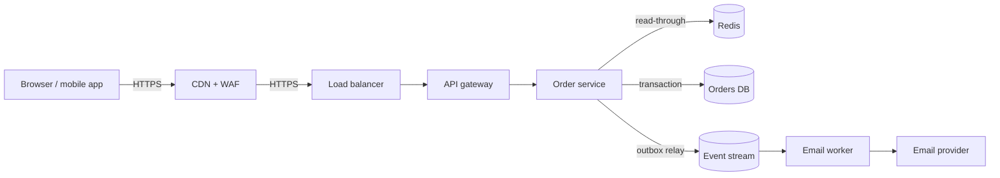
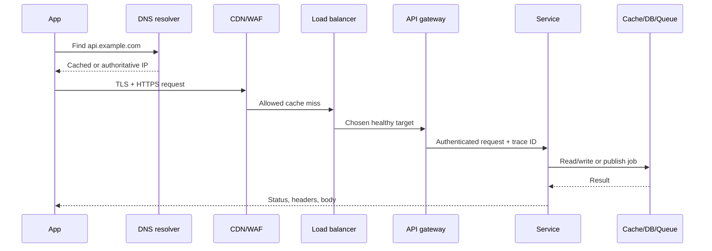

# 01 — Foundations: How Systems Work

## 1. What system design is

System design is the practice of selecting components, their boundaries, data flows, and operational rules so a product meets its promises under expected load and failure. It is not a single diagram. A complete design says what happens on a normal request, when load grows, and when dependencies fail.

### HLD and LLD

**High-level design (HLD)** explains major building blocks and why they exist: clients, CDN, gateway, services, cache, queue, database, object storage, and monitoring. Its audience is a team deciding scope and trade-offs.

**Low-level design (LLD)** explains how one component works: classes/modules, table schema, indexes, API fields, retry algorithm, state transitions, and test cases. Its audience is the engineer implementing it.

| Question | HLD answer | LLD answer |
|---|---|---|
| Where does a redirect look up a link? | A redirect service reads a cache, then the link database. | `links(code PK, destination, expires_at)` plus `idx_links_expiry`; cache key `link:{code}`. |
| How is traffic spread? | Load balancer routes to stateless service replicas. | Least-connections algorithm, 5-second readiness probe, 30-second drain. |
| What if analytics is slow? | Put analytics behind an event stream. | Event JSON schema, partition key, retry topic and consumer idempotency key. |

### Architecture diagrams: draw more than boxes

An useful diagram labels arrows with a protocol or important data: `HTTPS`, `SQL transaction`, `cache get`, `event: OrderPlaced`. Put trust boundaries, replicas, and sync vs async paths on the picture. Do not imply a guarantee that is absent.



This diagram says that the email is asynchronous: an order can succeed even if the email provider is unavailable. It does **not** say Redis is the source of truth; the database is.

## 2. Requirements before architecture

### Functional versus non-functional requirements

Functional requirements describe what users can do. Examples: “a user creates a private note,” “an admin revokes a token,” and “a buyer reserves a seat.”

Non-functional requirements describe the quality boundary: response time, availability, durability, privacy, cost, legal retention, accessibility, and ease of operation.

Turn vague statements into testable targets:

| Vague request | Testable target |
|---|---|
| “Fast redirects” | `GET /{code}` p99 < 100 ms at the chosen region edge. |
| “Never lose orders” | Once `201 Created` is returned, order data survives loss of one availability zone. |
| “Highly available” | 99.95% successful checkout availability per month; planned maintenance excluded only if contract says so. |
| “Secure” | TLS externally and internally, least-privilege roles, encrypted backups, audit records for admin actions. |

Scope controls the answer. Ask: Who are the users? Peak traffic? Regions? Read/write ratio? Required ordering? Can data be eventually consistent? What is explicitly not being built in v1?

## 3. Constraints and their tensions

- **Latency:** elapsed time experienced by a request. Tail percentiles matter because users experience the slow requests.
- **Throughput:** completed work per second. A system can have good throughput but terrible latency when queues grow.
- **Availability:** ability to serve valid requests. Timeouts and wrong answers both damage availability.
- **Consistency:** rules about which writes a read can see. Stronger guarantees usually need coordination.
- **Durability:** probability that acknowledged data survives crash or disaster.
- **Scalability:** ability to increase capacity without rewriting the whole system.
- **Cost:** compute, storage, network egress, managed-service fees, and people time.
- **Security and privacy:** authentication, permissions, isolation, encryption, retention, and auditability.

There is no universal maximum. A globally synchronized inventory counter might choose correctness over latency. A “likes” counter might choose low latency and accept a briefly stale number.

## 4. Back-of-the-envelope estimation

Estimation makes a design concrete. Keep units visible and declare assumptions.

### Worked example: image sharing service

Assume 2 million daily active users, each uploads 0.1 images/day on average, average stored image 3 MB, and peak traffic is 10× average.

```text
writes/day       = 2,000,000 × 0.1 = 200,000 uploads/day
average upload/s = 200,000 / 86,400 ≈ 2.3 uploads/s
peak upload/s    ≈ 23 uploads/s
new storage/day  = 200,000 × 3 MB = 600 GB/day
one-year raw     ≈ 219 TB (before replicas, thumbnails, and deletion)
peak ingress     = 23 × 3 MB/s ≈ 69 MB/s
```

If every upload produces three 200 KB thumbnails, add about 120 GB/day. If objects are copied three times, multiply physical storage by roughly three. Object storage fits image bytes; a database should store metadata, ownership, content type, checksum, and object key.

### Estimation patterns

| Need | Simple calculation | Hidden assumptions to say aloud |
|---|---|---|
| Requests/second | daily requests ÷ 86,400 | peak factor, retries, bots, background work |
| Concurrent users | RPS × average request duration | whether waiting connections count |
| Storage | records/day × bytes × retention | indexes, replicas, backup, compression, deletion |
| Bandwidth | RPS × payload bytes | response plus request, TLS overhead, cache hit ratio |
| Cache capacity | hot keys × average value bytes | metadata, replication, expiry, overhead |
| Queue backlog | incoming rate − processing rate | burst duration, retry rate, recovery throughput |

Do not pretend estimates are facts. The value is knowing what measurement would change your design.

## 5. Basic application shapes

### Client-server and request lifecycle

A client makes a request; a server applies business rules and returns a response. Modern systems often add layers that each have a narrow job.



An edge cache may answer without contacting the origin. A WAF may block a malicious request. A gateway may reject an expired token. Each layer alters the normal path and should be observable.

### MVC, layered and n-tier architecture

**MVC** separates a web-facing controller, a model holding domain data/rules, and a view presenting results. It is useful in one application, but it is not a distributed-system architecture.

**Layered / three-tier** architecture commonly has presentation, application/business, and data layers. Dependencies should point downward; the UI should not execute database queries directly.

**N-tier** extends this with API gateways, integrations, caching, background workers, and analytics. More tiers can isolate concerns, but every remote hop adds latency and a failure mode.

### Stateful and stateless services

A **stateless** service keeps no request-specific session only in its own memory. Any healthy replica can serve the next request, so it is easy to replace and horizontally scale. Configuration can still be injected; “stateless” does not mean “uses no database.”

A **stateful** service owns durable or in-memory state tied to an instance, such as a database node or a WebSocket session. It needs stable identity, replication, recovery, and careful placement. Keep stateful parts few and deliberate.

## 6. Choosing a deployment shape

| Shape | Definition | Good fit | Main risk |
|---|---|---|---|
| Monolith | One deployable application, often one database | early product, small team, cohesive domain | tangled modules and slow independent releases |
| Modular monolith | One deployment with strict internal module boundaries | most new products | boundaries can be ignored without discipline |
| Microservices | independently deployable services around business capabilities | domains/teams need independent scaling or release | network failure, data consistency, operations overhead |
| SOA | services often integrated through shared enterprise contracts/bus | enterprise integration | central coupling and slow change |
| Serverless | provider runs short-lived functions on demand | event handlers, irregular jobs, simple APIs | cold starts, execution limits, vendor-specific operations |

Start with a modular monolith unless an actual constraint requires distributed services. Extract a service when it has a clear owner, independent release cadence, data boundary, and measurable need—not merely because it has a different class.

## 7. Synchronous and asynchronous work

**Synchronous** communication means the caller waits for an answer now (HTTP/RPC). Use it when the user needs an immediate decision: authentication, price validation, stock reservation.

**Asynchronous** communication means the caller records work and continues; a worker processes it later (queue/event). Use it for email, thumbnails, analytics, exports, and workflows that can report progress.

The key design question is: *what state may the user believe after this response?* If checkout returns “paid,” the durable payment decision must already exist. “Receipt email queued” can happen afterward.

## 8. First-principles review checklist

- What is the source of truth for each important fact?
- What happens if a request is duplicated after a timeout?
- Which calls are on the user’s critical path?
- How much load reaches each dependency after caching and fan-out?
- Can any instance disappear without data loss or a visible outage?
- What metric proves the promise is currently being kept?

### Practice

Draw an HLD for “save a note.” Then add: private sharing, attachment uploads, email notifications, and search. At each addition, explain why a database, object store, queue, and search index do—or do not—become necessary.
