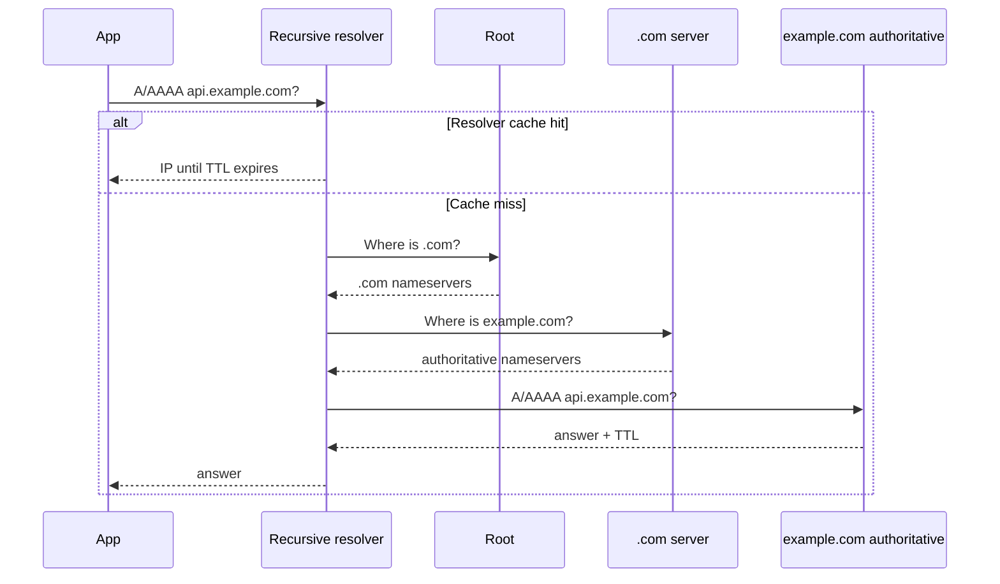

# 02 — Networking and Internet Fundamentals

## 1. Addresses, ports, sockets, and NAT

An **IP address** identifies a network interface for routing. IPv4 has 32 bits (for example `203.0.113.10`); IPv6 has 128 bits (for example `2001:db8::10`) and provides a far larger address space. A **private** address is reusable inside a private network and cannot be routed directly on the public Internet. A **public** address is globally routable.

A **port** identifies a process endpoint on an IP address. HTTPS conventionally uses TCP port 443; PostgreSQL commonly uses 5432. A **socket** is the endpoint combination of transport protocol, IP, and port. One TCP connection is uniquely identified by source IP/port and destination IP/port.

Because private addresses are not public, a NAT gateway rewrites outbound packets: many private clients share one public IP with distinct source ports. This helps address conservation but makes unsolicited inbound connections difficult; load balancers or port forwarding provide controlled entry.

## 2. DNS: translating names to destinations

DNS maps a name such as `api.example.com` to records. A device asks a **recursive resolver**, usually supplied by the ISP, OS, or a public provider. If it has no valid cached answer, it follows delegation from root to top-level domain to the domain’s **authoritative** nameserver.



Important records:

| Record | Meaning | Typical use |
|---|---|---|
| A / AAAA | IPv4 / IPv6 address | service hostname |
| CNAME | alias to another hostname | `www` pointing to CDN hostname |
| MX | mail exchanger | inbound email |
| TXT | free-form verified text | SPF, domain verification |
| NS | authoritative nameserver | domain delegation |
| SRV | service location including port | some internal/service protocols |

**TTL** is a caching lifetime, not an instant global switch. A low TTL can make changes propagate sooner after caches expire but adds resolver queries. For failover, use health-aware routing where available, plan for stale answers, and make both old and new destinations safe during the transition.

## 3. TCP, UDP, QUIC and connection behaviour

### TCP

TCP is a reliable, ordered byte stream. It creates a connection with a three-way handshake:

```mermaid
sequenceDiagram
  participant C as Client
  participant S as Server
  C->>S: SYN (sequence x)
  S->>C: SYN-ACK (sequence y, ack x+1)
  C->>S: ACK (ack y+1)
  Note over C,S: Ordered bytes flow; lost segments are retransmitted
```

It uses sequence numbers, acknowledgements and retransmissions to recover from loss. Flow control protects the receiver; congestion control reduces sending pressure when the network looks congested. A connection costs a handshake and state, so HTTP keep-alive or connection pools reuse it. TCP does *not* guarantee that your HTTP request ran exactly once: a timeout can occur after the server committed a write.

### UDP and QUIC

UDP sends independent datagrams with no built-in delivery, ordering, or connection setup. It suits DNS, games, and real-time media where late packets are useless. Applications must supply any needed reliability.

QUIC runs over UDP and supplies secure, multiplexed reliable streams at the transport layer. HTTP/3 uses QUIC. It reduces transport-level head-of-line blocking: loss on one stream need not stop unrelated streams. TLS is integrated into QUIC setup.

| Feature | TCP | UDP | QUIC (under HTTP/3) |
|---|---|---|---|
| Delivery/order | built in | application choice | reliable per stream |
| Connection setup | handshake | none | combined secure setup |
| Typical HTTP version | HTTP/1.1, HTTP/2 | custom protocols | HTTP/3 |
| Good for | APIs, databases | media, DNS | modern web over lossy networks |

## 4. TLS, HTTPS and certificates

TLS authenticates the server and encrypts data **in transit**. In simplified terms, the client validates the server certificate chain and domain name, negotiates cryptographic parameters, and derives short-lived symmetric keys. Symmetric encryption then protects the high-volume data because it is efficient.

HTTPS is HTTP carried inside TLS. TLS does not secure a vulnerable application; it prevents many network observers and attackers from reading or changing traffic in transit. Use modern TLS, automate certificate renewal, disable obsolete protocols/ciphers, and encrypt internal service-to-service paths too when the trust model requires it.

Do not place secrets in URLs: URLs can enter browser history, proxy logs, referrer headers, and analytics. Put credentials in secure headers or request bodies where appropriate.

## 5. HTTP fundamentals

HTTP is an application protocol built around request and response messages.

```http
POST /v1/orders HTTP/1.1
Host: api.example.com
Authorization: Bearer <access-token>
Idempotency-Key: 5a8d...
Content-Type: application/json

{"sku":"book-42","quantity":1}
```

```http
HTTP/1.1 201 Created
Content-Type: application/json
Location: /v1/orders/o_123
X-Request-Id: req_abc

{"id":"o_123","status":"pending"}
```

### Methods and status codes

| Method | Intended meaning | Idempotent? | Notes |
|---|---|---|---|
| GET | retrieve representation | yes | must not create side effects |
| POST | create/action under collection | not automatically | idempotency key for retryable creation |
| PUT | replace a known resource | yes by intent | send full representation |
| PATCH | partial change | depends | define conflict semantics |
| DELETE | remove a resource | yes by intent | repeated delete may return 404/204 by contract |

Use `2xx` for success, `400` for invalid client input, `401` for no/invalid authentication, `403` for authenticated but forbidden, `404` for absent/hidden resource, `409` for state conflict, `429` for rate limits, and `5xx` when the server failed. A `503` may include `Retry-After` when a retry is reasonable.

### HTTP versions and compression

- **HTTP/1.1** supports persistent connections but browsers often opened multiple connections because one response could block later responses on a connection.
- **HTTP/2** multiplexes streams on one TCP connection and compresses headers. TCP packet loss can still delay all streams on that connection.
- **HTTP/3** uses QUIC multiplexed streams, avoiding that TCP-level coupling.

Compress suitable text (`br` or gzip) but not already-compressed images/video. Set `Content-Encoding` and correctly vary caches with `Vary: Accept-Encoding`.

### Cookies, CORS and browser boundaries

A cookie is browser-managed state sent according to domain/path rules. Use `Secure` (HTTPS only), `HttpOnly` (JavaScript cannot read it), and an appropriate `SameSite` value. Cookies can create CSRF risk because the browser may attach them automatically.

CORS is a browser rule, not server-to-server security. The server grants selected origins/methods/headers using response headers. Do not return `Access-Control-Allow-Origin: *` with credentials; explicitly allow trusted origins and validate them.

## 6. Proxies, firewalls and VPNs

A **reverse proxy** is in front of servers: it terminates TLS, routes requests, serves cache, and hides origin addresses. An **API gateway** is a reverse proxy with API-specific policy such as authentication, rate limits, and transformations.

A **forward proxy** is selected by clients to reach external services, for egress control, privacy policy, or caching. A **firewall** allows or denies network flows based on policy. A **VPN** encrypts and authenticates a network tunnel; it is not a replacement for application authorization.

Use default-deny network rules. Only the gateway should normally receive Internet traffic; database ports should accept traffic only from approved application identities or networks.

## 7. CDN, edge cache, origins, geo-routing and anycast

A CDN keeps cached static or cacheable dynamic responses near users. The **origin** is the source application/storage. Correct cache-control is part of the API contract:

```http
Cache-Control: public, max-age=60, s-maxage=300, stale-while-revalidate=30
ETag: "asset-v17"
```

`max-age` tells browsers a freshness period; `s-maxage` lets shared caches use a different period; an ETag enables conditional revalidation. Never shared-cache personalized responses unless keys and headers deliberately prevent cross-user leakage.

Geo-routing returns a nearby/healthy regional endpoint. **Anycast** announces the same IP from several locations; Internet routing normally sends a client to a topologically nearby advertisement. Anycast is excellent for stateless edge services, but do not assume it gives a client permanent affinity.

## 8. Real-time communication choices

| Mechanism | Direction | Good for | Watch out for |
|---|---|---|---|
| Long polling | client asks, server waits | simple infrequent updates | reconnection overhead |
| Server-Sent Events | server → browser | notifications, progress feeds | one-way; reconnection IDs needed |
| WebSocket | two-way persistent channel | chat, collaboration, presence | connection state, backpressure, auth refresh |
| WebRTC | peer-to-peer media/data | video/audio calls | NAT traversal, signaling, TURN relay |

For WebSockets, authenticate at connection setup, authorize each message/action, cap payloads, use heartbeats, and have a plan for reconnect and missed messages. Keep presence approximate; a network drop cannot always be distinguished from a closed browser immediately.

## 9. Application protocol selection

- **REST/HTTP:** resource-oriented public APIs, caching, broad tool compatibility.
- **RPC/gRPC:** typed service-to-service calls, streaming, compact binary payloads; still set deadlines and retries carefully.
- **GraphQL:** client-selected response shape; useful for varied clients, but needs query-cost limits, authorization per resolver, and anti-N+1 batching.
- **SOAP:** formal XML contracts and legacy enterprise interoperability.
- **MQTT:** lightweight pub/sub, often devices and unreliable networks.
- **AMQP:** brokered messaging with queues/routing patterns.

Selection is about interoperability, type safety, latency, streaming, operational tools, and security—not fashion. Every protocol still needs identity, authorization, timeouts, versioning, quotas, and observability.

## 10. Troubleshooting a slow request

Trace the path instead of guessing: DNS lookup time, TCP/QUIC connection time, TLS time, time to first byte, server duration, database time, and response download. Give each request a correlation ID and propagate trace context through all downstream calls. Network error? Check DNS answers, certificate validity, firewall rules, load-balancer health, then application metrics.
