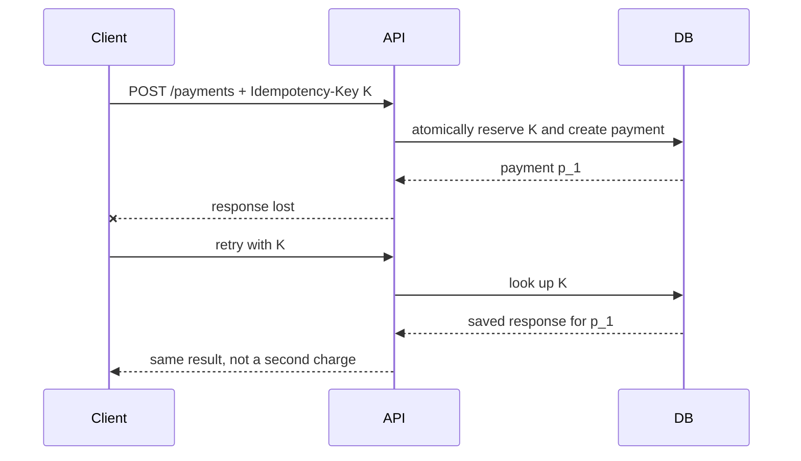

# 03 — Requirements, API Design, Service Resilience and Security

## 1. A repeatable design/interview process

In a 45–60 minute design discussion, time-box the stages: 5 minutes requirements, 5 estimates, 10 APIs/data model, 15 architecture/flow, 10 scale/failure/security, and 5 trade-offs. Say assumptions out loud and revise them when new facts appear.

Questions that change the design: Is a read allowed to be stale? Is ordering global or only per user? What happens after a payment timeout? Is the traffic predictable? Is tenant data legally isolated? Which regions are required? What is the data-retention period?

## 2. API contracts that survive change

### Resource modeling and URLs

Prefer nouns and stable identifiers:

```text
POST   /v1/orders
GET    /v1/orders/{orderId}
GET    /v1/orders?status=paid&sort=-createdAt&limit=50
POST   /v1/orders/{orderId}:cancel     # explicit domain action when needed
```

Use plural collections, predictable JSON casing, ISO-8601 timestamps with timezone, and opaque IDs. URL versioning (`/v1`) is simple for public APIs; additive fields can normally be introduced without a new version. Do not silently change a field’s meaning, type, auth rule, or ordering.

### Pagination, filtering, sorting, searching

**Offset pagination** (`?offset=100&limit=50`) is easy but gets slower for deep pages and can duplicate/skip rows while records change.

**Cursor/keyset pagination** uses a stable position, typically sort fields plus a unique tiebreaker. It performs well with a matching index and is more stable under inserts.

```http
GET /v1/events?limit=2&cursor=eyJjcmVhdGVkQXQiOiIyMDI2LTA3LTEwVDEwOjAwOjAwWiIsImlkIjoiZV8xIn0
```

The cursor should be opaque and signed or validated; it is an implementation detail, not a user-editable offset. Define a deterministic sort (`created_at DESC, id DESC`) and encode both fields.

### Validation and a consistent error body

Validate type, range, format, allowed state transition, caller permissions, and resource ownership. Return a machine-readable code, a safe human message, a request ID, and field-specific problems when helpful.

```json
{
  "error": {
    "code": "VALIDATION_FAILED",
    "message": "One or more fields are invalid.",
    "requestId": "req_7f2",
    "fields": [{"name": "quantity", "reason": "must be between 1 and 20"}]
  }
}
```

Never leak SQL, stack traces, tokens, or whether a private account exists. Log diagnostic detail internally with the same request ID.

### Idempotency: safe retries for uncertain writes

Failure sequence: client sends a payment request; server commits it; response is lost; client retries. A plain POST can create two charges. An idempotency key makes repeated requests converge on one result.



Store the key, authenticated principal, normalized request hash, status, and response for a defined window. If a reused key has a different request hash, reject it. The database uniqueness constraint is the final guard; an in-memory cache alone is not enough.

## 3. API gateway, BFF, discovery, and balancing

An **API gateway** centralizes cross-cutting edge policy: TLS, authentication, request-size limits, rate limits, routing, tracing, and sometimes aggregation. Do not move all business rules there; that creates a giant, coupled gateway.

A **BFF** (backend for frontend) shapes APIs for a specific client such as web or mobile. It can reduce round trips and hide internal service topology, but should not duplicate core domain logic.

**Service discovery** maps a logical name to healthy instances. With client-side discovery, the caller chooses an instance; with server-side discovery, a proxy/load balancer chooses. A registry must expire dead entries and avoid sending traffic to merely started-but-not-ready processes.

| Load-balancing algorithm | Best intuition | Caution |
|---|---|---|
| Round robin | equal, similar requests | ignores long-running work |
| Weighted round robin | targets differ in capacity | weights need maintenance |
| Least connections | requests have varied duration | active connections may not equal CPU work |
| Least response time | favor faster targets | can amplify measurement noise |
| IP hash | simple client affinity | uneven clients create imbalance |
| Consistent hashing | route a key to stable owner | still need virtual nodes and failure handling |

Health endpoints have distinct purposes: **startup** says the process has initialized, **readiness** says it may receive traffic, and **liveness** says it is not irrecoverably stuck. Do not make liveness fail because a remote dependency is briefly down; that can restart every replica during an outage.

## 4. Resilience patterns: bound failure, do not multiply it

Every remote call needs a deadline. A timeout bounds waiting but does not cancel downstream work automatically. Retry only transient, safe operations; limit attempt count and total retry budget.

```python
# Illustrative retry policy: each line is explained below.
def retry(operation, max_attempts=3):
    for attempt in range(max_attempts):              # 1. Bound retries.
        try:
            return operation(timeout_seconds=0.8)    # 2. Always set a deadline.
        except TransientError:
            if attempt == max_attempts - 1:          # 3. Last attempt: expose failure.
                raise
            ceiling = min(0.1 * (2 ** attempt), 2)   # 4. Exponential cap: 0.1, 0.2, 0.4s.
            sleep(random.uniform(0, ceiling))        # 5. Full jitter spreads retries.
```

1. An unbounded loop turns a temporary fault into permanent overload.
2. The deadline must fit within the caller’s own deadline; pass remaining budget downstream.
3. Do not hide final failure. Return a safe error or enqueue work if the product allows it.
4. Exponential backoff backs off quickly; the maximum prevents huge waits.
5. Jitter prevents thousands of clients retrying in synchronized waves.

A **circuit breaker** stops calling a dependency after a threshold of failures, returns a fallback, then allows limited probes to see whether it recovered. A **bulkhead** reserves pools (connections, threads, queues) so an overloaded recommendation dependency cannot consume resources needed by checkout. **Backpressure** tells senders to slow down; **load shedding** rejects low-priority work deliberately instead of timing out all work.

## 5. Rate limits, quotas and abuse control

Rate limiting protects availability and fair use. Common algorithms:

| Algorithm | Idea | Strength | Limitation |
|---|---|---|---|
| Fixed window | count in minute/hour bucket | simple | bursts at boundary |
| Sliding log | keep timestamps | accurate | memory-intensive |
| Sliding window counter | combine adjacent buckets | good compromise | approximate |
| Token bucket | tokens refill; each request consumes one | allows controlled bursts | shared state required |
| Leaky bucket | release at fixed rate | smooths output | queues/delays work |

Limit by a trusted identity (account/API key), not just IP. Use separate limits for expensive endpoints, body-size limits, WAF/bot rules, anomaly detection, and clear `429` responses. Quotas are longer-period allowances; rate limits are short-period pace controls.

## 6. Authentication and authorization

**Authentication** answers “who is this?” **Authorization** answers “may this identity perform this action on this resource?” Successful login is not permission to read every record.

### Sessions and cookies

With a server-side session, the browser stores a random session ID in a cookie; the server stores session state. Rotate session IDs at login/privilege change, expire them, revoke them on logout, and use `HttpOnly`, `Secure`, and an appropriate `SameSite` setting. Protect state-changing cookie-authenticated endpoints with CSRF defences.

### JWT access and refresh tokens

A JWT is a signed container of claims; it is not encrypted by default. A short-lived access token can be verified without a database call, but immediate revocation is harder. Use short expiry, audience/issuer checks, key rotation, and do not put sensitive data in claims.

Refresh tokens last longer and obtain new access tokens. Store them securely, rotate on use, detect reuse, and revoke the token family if a rotated token reappears. For browser applications, understand XSS and CSRF consequences before choosing cookie versus script-readable storage.

### OAuth 2.0 and OpenID Connect

OAuth 2.0 delegates authorization; OpenID Connect adds standardized user identity on top. For user-facing apps use **authorization code flow with PKCE**: the app sends user to the identity provider, receives a short-lived code, and exchanges it with a verifier. PKCE protects public clients from a stolen authorization code. Use **client credentials** only for a machine acting as itself, not as a user.

SSO lets one identity provider authenticate users across applications. SAML is an older XML-based SSO protocol common in enterprises; OIDC is often more convenient for modern web/mobile applications.

### Permissions and tenancy

- **RBAC:** roles contain permissions (e.g., `billing_admin`). Simple and auditable.
- **ABAC:** policy evaluates attributes (tenant, department, resource owner, time). Flexible, harder to reason about.
- **Scopes:** named delegated permissions in a token, such as `orders:read`.

Always enforce tenant ID from trusted authentication context and validate ownership in queries. Never accept an arbitrary `tenantId` in a request and use it without comparison to the caller’s allowed tenancy.

## 7. Application security essentials

### Passwords and MFA

Store passwords with a password hashing function designed for the purpose, such as Argon2id or bcrypt, using a unique salt. Never use reversible encryption or fast hashes (MD5/SHA alone) for passwords. Rate-limit login, protect recovery flows, notify of sensitive changes, and support MFA/passkeys where the risk warrants it. WebAuthn/passkeys use public-key cryptography and resist phishing better than typed passwords.

### Common web attacks

| Threat | What it is | Primary controls |
|---|---|---|
| XSS | attacker script runs in a trusted page | contextual output encoding, safe templates, CSP, avoid unsafe HTML |
| CSRF | browser sends victim cookie on attacker-triggered request | SameSite cookies, CSRF tokens, origin checks |
| SQL/NoSQL injection | input changes query meaning | parameterized queries, allowlists, least DB privilege |
| Clickjacking | site framed to trick a click | CSP `frame-ancestors` / frame restrictions |
| SSRF | server fetches attacker-chosen internal address | URL allowlist, egress rules, metadata protection |
| Broken access control | valid user accesses another user’s data | authorize every object/action server-side |

Example safe SQL uses bound values, not concatenation:

```python
# The driver sends the SQL structure and value separately.
row = db.execute(
    "SELECT id, email FROM users WHERE tenant_id = %s AND id = %s",
    (authenticated_tenant_id, requested_user_id),
).fetchone()
```

The SQL syntax is fixed. The database treats both values as data, so a malicious ID cannot terminate the condition and add SQL.

### Platform and data security

Use a WAF and upstream DDoS protection, but still enforce application-level validation and quotas. Encrypt data in transit and at rest. A KMS manages encryption keys; applications should retrieve short-lived permission to use keys rather than embed key material. Use a secret manager, rotation, least privilege, and audit access.

Signed object URLs/cookies grant a narrowly scoped, short-lived upload/download capability. Bind them to method, object path, size/content-type conditions where possible. Do not turn a signed URL into a permanent bearer credential.

Audit sensitive actions with actor, target, action, outcome, time, request ID, and non-secret context. Define retention and legal deletion policies. Mask PII in logs; GDPR-style deletion often requires deleting primary rows, derived indexes, caches, replicas, exports, and backups according to an approved policy.

## 8. Change management

Feature flags separate deployment from release. Flags need ownership, expiry, targeting rules, audit history, and a removal date; stale flags become hidden configuration bugs. Deprecate APIs by announcing a timeline, measuring clients, maintaining compatibility, offering migration help, and eventually returning clear sunset errors. Configuration belongs in versioned, validated, access-controlled systems—not ad hoc environment changes on a production server.
