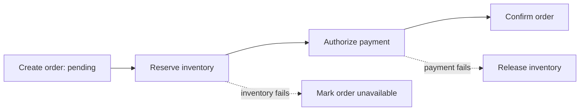
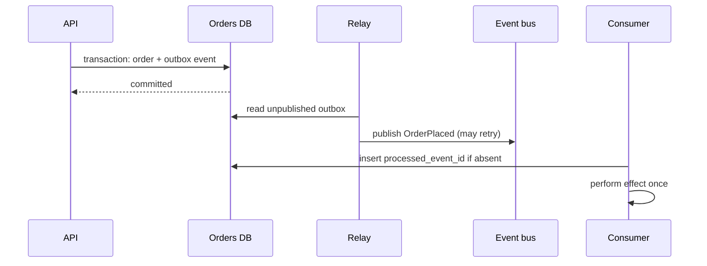

# 05 — Distributed Systems: Consistency, Coordination and Failure

## 1. Why distributed systems are difficult

One machine can crash, but its memory and disk are locally observable. Multiple machines introduce **partial failure**: service A cannot reach service B, while B is healthy and can reach C. A timeout is ambiguous: did the request never arrive, arrive but not finish, or finish but lose its response?

Clocks drift, messages can be delayed/reordered/duplicated, and a network partition can make two healthy groups believe the other is dead. Design around these facts; do not use “the network is reliable” as an assumption.

## 2. CAP and PACELC without slogans

During a network **P**artition, CAP says a replicated system cannot simultaneously guarantee every operation receives a response (**A**vailability) and every operation sees one single current value (**C**onsistency, often linearizability). A system must choose behavior for a particular operation: reject/wait to preserve consistency, or respond from a reachable replica and possibly be stale/conflicting.

CAP does not mean “always choose two of three,” and normal latency matters even when no partition occurs. PACELC adds: **if** partition, choose A or C; **else**, choose latency (L) or consistency (C). Strong cross-region coordination may preserve a guarantee but add latency.

## 3. Consistency models

| Guarantee | Plain-English promise | Example use |
|---|---|---|
| Strong / linearizable | operations appear to occur once, in real-time order | a single remaining ticket |
| Serializability | transactions act like some one-at-a-time order | money transfer transaction |
| Eventual | replicas converge if writes stop | a like count, search document |
| Read-your-writes | session sees its own acknowledged write | profile edit then view |
| Monotonic reads | session does not go backward to older data | activity feed pagination |
| Causal | effects are not seen before their causes | reply after original message |

Linearizability and serializability are different. A database can serialize transactions in an order that does not respect wall-clock completion; linearizability adds real-time ordering for individual operations. Name the exact invariant: “never oversell seat 12” may need a strongly coordinated reservation, while “available seats count may lag” need not.

## 4. Quorums, replicas and conflicts

For `N` replicas, a write quorum `W` and read quorum `R` overlap when `R + W > N`. Example: `N=3, W=2, R=2`; any read and successful write share at least one replica. This can improve fault tolerance, but no simple formula replaces version handling, repair, membership changes, and client routing.

Concurrent writes need a policy:

- **Last-write-wins** is simple but can silently lose a real update; physical clocks can be wrong.
- **Merge fields/CRDTs** works for data structures designed to merge, such as grow-only counters or observed-remove sets.
- **Application resolution** presents a conflict or selects an authoritative workflow.

Do not use a distributed quorum to avoid designing product semantics. Decide which action wins and whether the user must be informed.

## 5. Reliable workflows: transactions, sagas and outbox

### Two-phase commit (2PC)

2PC asks participants to prepare (promise they can commit) then tells them commit/abort. It can provide atomic cross-resource transaction behavior, but adds latency, locks/resources, and coordinator failure complexity. It is often unsuitable for independently operated services or external payment/email providers.

### Saga

A saga breaks a business workflow into local transactions with compensating actions. Compensation is a new business action, not a magical rollback: “release inventory reservation” may be possible; “unsend an email” is not.



**Choreography** lets services react to events. It is decoupled but the full workflow can be hard to see. **Orchestration** uses a workflow coordinator/state machine to issue commands and record state. It is easier to visualize/time out/retry, but the orchestrator becomes important infrastructure. Select based on workflow complexity and ownership.

### Transactional outbox and inbox

The dual-write problem: a service commits an order in its database, then crashes before publishing `OrderPlaced`; or publishes first then the DB transaction fails. The **outbox pattern** writes the domain change and event row in one local transaction. A relay later publishes the outbox row and marks it delivered. At-least-once publishing is expected, so consumers must be idempotent.



An **inbox** stores processed event IDs with the consumer’s local state update, usually under a unique constraint. This delivers an “exactly once effect” for that local transaction, not an impossible global exactly-once guarantee.

## 6. Delivery semantics and idempotency

- **At-most-once:** message may be lost, never retried. Good only when loss is acceptable.
- **At-least-once:** retries mean no loss after accepted delivery, but duplicates are possible. Most practical systems use this.
- **Exactly-once:** commonly means a limited broker guarantee or a deduplicated outcome; end-to-end effects still need idempotency.

Give every command/event a durable ID. Make consumers record it or make writes naturally idempotent (for example, `INSERT ... ON CONFLICT DO NOTHING` on an event ID). Do not deduplicate by message payload: two legitimate actions can have identical content.

## 7. Locks, leases and fencing tokens

Distributed locks are dangerous when processes pause or networks partition. A lease can expire while the old owner is still running. The old owner can then overwrite work done by the new owner.

Use a **fencing token**: every lock grant has a monotonically increasing number. The protected resource rejects writes from older tokens. A lock alone controls intent; the resource must enforce ordering.

```text
worker A gets lease token 41, pauses
lease expires; worker B gets token 42 and writes
worker A wakes and tries write with token 41
database/storage rejects 41 because 42 was already accepted
```

Prefer a database unique constraint, atomic compare-and-set, or queue partition ownership over a general distributed lock where possible.

## 8. Leader election and consensus

Leader election lets a group select one coordinator. The Bully algorithm conceptually prefers the highest-ID live node; a ring algorithm passes election messages around a ring. These are useful learning models but production systems need durable membership, failure detection, and epochs/terms.

Raft is a consensus algorithm that elects a leader, replicates an ordered log, and commits entries once a majority acknowledges them. Terms prevent an old leader from acting after a newer election. Paxos solves related consensus problems but is often considered harder to explain. Both create a replicated state machine: nodes apply the same committed commands in the same order.

Consensus is for small, critical coordination sets (metadata, configuration, leader choice), not every high-volume user write across the planet.

## 9. Time, clocks, and membership

Physical clocks can drift or jump. Use monotonic clocks for durations/timeouts; use NTP carefully for wall time. **Lamport clocks** attach a scalar logical counter that captures “happened before” ordering but cannot identify all concurrency. **Vector clocks** track counters per actor and can distinguish concurrent updates, at higher metadata cost.

Failure detectors use heartbeats and timeouts. They are suspicions, not proof: a slow node can look dead. Membership protocols spread join/leave/failure information; tune them for detection speed versus false positives. Avoid a false positive that causes two leaders or an unnecessary data move.

## 10. Failure handling patterns

### Timeouts, retries and retry storms

Set deadlines at the entry point and allocate a budget to downstream calls. Retry only error types and operations proven safe; use exponential backoff plus jitter; cap concurrent retries. A small 1% dependency failure can become a total outage if every caller sends three retries while queues build.

### Graceful degradation

Classify work. Checkout authorization might be essential; personalized recommendations are optional. When a dependency fails, return a safe default, cached value marked as stale where appropriate, a “try later” response, or disable a feature through a flag. Never silently degrade a correctness-critical decision.

### Split-brain prevention

Split brain means two nodes/groups act as leader. Prevent it through quorum-based consensus, leases with fencing, majority membership, and storage that rejects stale terms. Recover by preserving evidence, preventing further writes from stale nodes, choosing an authoritative log/data copy, reconciling carefully, and documenting the incident.

## 11. A practical correctness checklist

- Can a caller tell whether an accepted request completed after a timeout?
- Is every externally visible write idempotent or safely conflict-detected?
- Are durable state change and emitted event coupled through an outbox?
- Does every async consumer tolerate duplicate and out-of-order messages?
- Are multi-step outcomes represented explicitly as states, including failure/compensation?
- What stale/partition behavior is acceptable for this exact user action?
- If a leader pauses, can it still mutate the protected resource after lease expiry?
