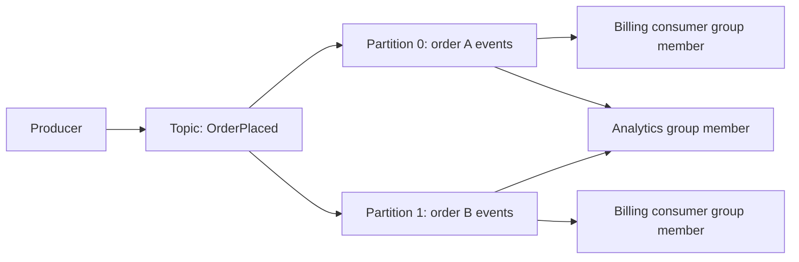

# 06 — Caching, Performance, Messaging and Streaming

## 1. Caching is a controlled copy

A cache stores a copy because recomputing or rereading it is expensive. The central question is not “should we use Redis?” It is “how stale may this value be, who invalidates it, and what happens during a miss?”

Cache layers include browser cache, DNS resolver cache, CDN, reverse proxy, application local memory, distributed cache, and database buffer cache. A hit at a nearer layer saves more latency and origin load, but makes invalidation harder.

**Redis** is commonly used as an in-memory data structure store for cache entries, counters, short-lived coordination, streams, and pub/sub. **Memcached** is a simpler distributed in-memory key-value cache with multi-threaded performance and no durable data structures. Neither is a durable source of truth by default. Choose Redis when its atomic structures/replication/operations match a measured need; choose Memcached when a simple ephemeral cache is all that is required.

### Core patterns

| Pattern | Read path | Write path | When it fits |
|---|---|---|---|
| Cache-aside | app checks cache; on miss reads DB and fills cache | app writes DB then invalidates/updates cache | general default |
| Read-through | cache fetches backing store itself | separate | application wants a cache abstraction |
| Write-through | read cache normally | write cache and backing store synchronously | consistency more important than write latency |
| Write-behind | cache serves/accepts changes | persist later async | high write throughput; durable-loss risk |
| Refresh-ahead | refresh before expiry | normal source writes | predictable hot keys |

Cache-aside pseudocode:

```python
def get_product(product_id):
    key = f"product:{product_id}"                 # 1. Stable, namespaced key.
    value = cache.get(key)                         # 2. Fast path: may be absent/stale.
    if value is not None:
        return value                               # 3. Return cached representation.
    value = db.fetch_product(product_id)           # 4. Source of truth on a miss.
    if value is None:
        cache.set(key, "__not_found__", ttl=30)   # 5. Brief negative cache prevents miss flood.
        return None
    cache.set(key, value, ttl=jitter(300, 0.1))    # 6. TTL limits staleness; jitter spreads expiry.
    return value
```

1. Key naming avoids collisions and enables targeted deletion.
2. A cache never replaces authorization; cache keys/values must be safe for the caller scope.
3. A hit is only valid if its freshness contract permits it.
4. Ensure the database has capacity for a miss storm.
5. Negative caching helps nonexistent hot IDs, but short TTL prevents hiding a newly created item too long.
6. Expiry jitter prevents many keys expiring in the same second.

After a write, commit the database transaction first, then delete the cache key (or publish an invalidation). Deleting makes the next read refill correct data. Updating cache directly can be correct but is more error-prone when concurrent writers exist. Versioned keys can make old versions naturally unreachable.

## 2. Eviction, invalidation, and common cache failures

- **TTL eviction:** value expires after a set time; simple bound on staleness.
- **LRU:** evict least recently used; good when recent popularity predicts future use.
- **LFU:** evict least frequently used; can preserve historically hot but now dead keys without decay.
- **FIFO:** evict oldest inserted; simple but often lower hit rate.

| Failure | Cause | Defences |
|---|---|---|
| Stampede/thundering herd | many requests rebuild one expired key | single-flight/request coalescing, soft TTL, lock with timeout, jitter |
| Cache penetration | repeated misses for nonexistent/random keys | validation, negative cache, rate limit, Bloom filter |
| Cache avalanche | many keys/servers expire/fail together | stagger TTLs, replicas, capacity, fallback |
| Hot key | one key overloads one cache shard | replicate key, local cache, request collapse, split workload |
| Stale/incorrect cache | invalidation missing or key lacks tenant/version | explicit contract, events, versioning, tests |

For user-facing correctness, label what can be stale. A product description may be 5 minutes old; account balance or authorization normally must not come from an unbounded stale cache.

## 3. Performance beyond caching

Compress text payloads, batch independent calls, reuse TCP/database connections, and move noncritical work to background consumers. Keep payloads small and paginate. Measure before optimization: an extra service hop, serialization, a slow query, garbage collection, connection pool queue, and network transfer can each dominate latency.

Tail latency compounds. If a request waits on five independent calls, each with 1% chance of being slow, the chance at least one is slow is about `1 - 0.99^5 ≈ 4.9%`. Reduce fan-out, set timeouts, cache safely, and run independent calls in parallel only if downstream capacity permits it.

## 4. Queue, pub/sub, and event stream are different

| Model | Main idea | Consumer behavior | Typical use |
|---|---|---|---|
| Work queue | one job handled by one worker | competing consumers share work | email, thumbnail, export |
| Pub/sub | every interested subscription receives event | fan-out to subscribers | notify multiple services |
| Event stream | durable ordered log split into partitions | consumers track position/offset | analytics, replay, event-driven state |

RabbitMQ/AMQP-style brokers emphasize queues, routing, acknowledgements. SQS-like systems offer managed queue delivery semantics. Kafka-like systems use durable topics/partitions, consumer groups and offsets. Redis Streams provides stream-like records with consumer-group concepts. Names differ; model delivery, ordering, retention, throughput, replay, and operations before choosing.

## 5. Topics, partitions, groups, and ordering

An event stream topic is divided into **partitions**. A partition is ordered; the whole topic is generally not. A partition key chooses the partition. Put all events for one order/account/chat into the same partition if that entity needs order. A hot partition key limits parallelism, so avoid global keys.

A **consumer group** spreads partitions among its consumers: within one group, one consumer processes a partition at a time; another group can independently consume the same topic. An **offset** is a consumer’s saved position. Commit an offset only after the required effect is durable, otherwise a crash can skip work.



## 6. Consumer reliability

Use a retry policy that distinguishes transient errors from invalid/poison messages. A **dead-letter queue (DLQ)** holds messages that exhausted retries, with the original payload, reason, attempt count, first/last failure time, and correlation ID. A DLQ is not a bin: assign ownership, alert, inspect, fix, and replay safely.

Poison messages may be schema-invalid or trigger a permanent business failure. Retrying them forever blocks useful work. Retry queues with scheduled delay avoid occupying a main consumer while waiting.

Idempotent consumer outline:

```sql
BEGIN;
INSERT INTO processed_events (consumer_name, event_id, processed_at)
VALUES ('email-worker', :event_id, now())
ON CONFLICT DO NOTHING;
-- Continue only if the INSERT inserted one row.
INSERT INTO email_jobs (event_id, recipient, template)
VALUES (:event_id, :recipient, 'order-confirmation');
COMMIT;
```

The `processed_events` uniqueness rule and the business-state change must be in the same local transaction. For an external email provider, the final send may still need a provider idempotency key or a durable send state; a crash between sending and recording result is ambiguous.

## 7. Schemas and compatibility

Events are long-lived contracts. Include event ID, type, occurred time, producer version, subject ID, and payload. A schema registry can enforce rules and preserve known versions. Prefer additive changes: add optional field with default semantics; do not rename/remove/change a field type until all consumers have migrated. Consumers should ignore unknown fields and validate required known fields.

Never publish a database row blindly as an event. An event expresses a business fact (`OrderPaid`), while a row contains internal representation that will evolve.

## 8. Webhooks

A webhook is an outbound HTTP event notification. The receiver can be down, so senders need durable delivery records, timeout, exponential retry with jitter, maximum attempts, event IDs, and a way for customers to inspect/replay attempts. Sign the raw request body (for example HMAC with a timestamp) and receivers must verify signature, timestamp freshness, and idempotently record event ID before processing. Never assume the receiver gets events once or in order.

## 9. Event sourcing, CQRS, and materialized views

**Event sourcing** stores a sequence of domain events as the primary history; current state is rebuilt by replay or snapshots. It provides audit/time-travel but makes schema evolution, query models, and correction workflow more complex. It is not needed for ordinary CRUD.

**CQRS** separates write commands from read queries. A write model protects invariants; read models are denormalized/materialized for fast queries. Event-driven projections are often eventually consistent. Tell the user whether a newly created object is immediately searchable or only immediately readable from its write source.

Stream processors consume events to form windows, aggregations, joins and materialized views. Event time is when something happened; processing time is when the system saw it. A **watermark** is an estimate that events before a time are unlikely to arrive, allowing a window to close while still handling late data by an explicit policy.

## 10. Design exercise: notification pipeline

Requirement: once an order is paid, send email and push notification; do not delay checkout; no duplicate user-visible notification if the broker retries.

1. Order service commits `paid` and an `OrderPaid` outbox event together.
2. Relay publishes event to a durable topic.
3. Email and push consumer groups independently consume it.
4. Each stores event/notification state under a unique key before/with scheduling external delivery.
5. Providers receive idempotency keys if supported; otherwise record provider message ID and reconcile ambiguous sends.
6. Permanent failures go to a DLQ and appear in an operator dashboard.
7. Metrics track outbox age, consumer lag, retry/DLQ count, provider success rate, and time from payment to delivery.
