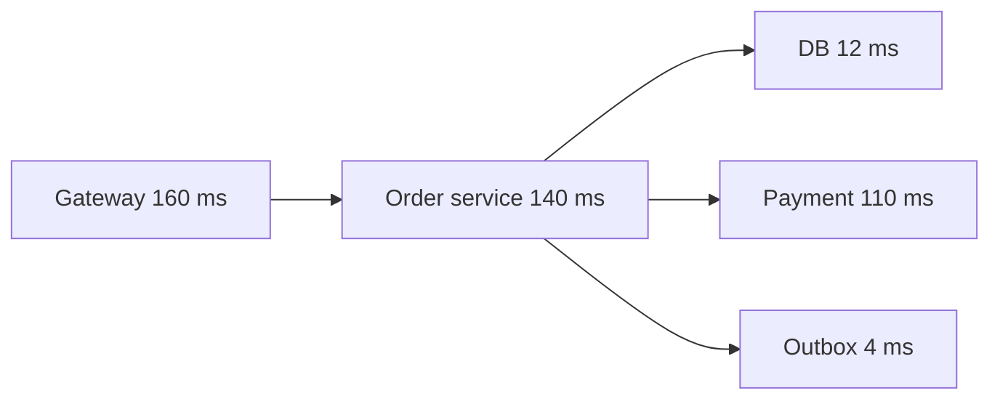

# 07 — Observability, Reliability and Operations

## 1. Observability: ask new questions from system output

Monitoring tells you known signals are abnormal. Observability gives enough high-quality telemetry to investigate an unknown failure path. The four main signal types are logs, metrics, traces, and profiles.

| Signal | Best for | Example |
|---|---|---|
| Structured logs | exact event detail | payment gateway response code for `order_id` |
| Metrics | aggregate trend, alert, capacity | p99 latency, queue depth, error rate |
| Traces | one request across services | gateway → order → DB → payment path |
| Profiles | code/CPU/memory hot spots | 40% CPU spent serializing JSON |

### Structured logging

Emit machine-readable fields rather than unstructured sentences. Include timestamp, level, service/version, environment, request/trace ID, actor/tenant ID where safe, operation, duration, result, and safe error class. Redact tokens, passwords, raw PII, and payment details at source. Logs should answer “what happened?” without becoming an unbounded data leak.

```json
{"level":"INFO","event":"order.created","request_id":"req_2c","trace_id":"a1","order_id":"o_9","tenant_id":"t_4","duration_ms":18}
```

## 2. Metrics and latency

A **counter** only increases (requests served, errors); a **gauge** rises/falls (queue depth, active connections); a **histogram** records distribution buckets (request duration). Histograms make percentile aggregation possible across instances. Percentiles show tail pain: p50 is median, p95 means 95% are no slower, p99 exposes the slowest 1%.

Avoid unbounded label/cardinality values such as user ID, order ID, or raw URL path in metrics. Use route templates (`/orders/{id}`), status class, region, and a controlled tenant tier instead.

Two practical metric lenses:

- **RED** for request services: Rate, Errors, Duration.
- **USE** for resources: Utilization, Saturation, Errors.

Example dashboard rows: traffic/error/latency; CPU/memory/GC; database connections/slow queries/replication lag; cache hit/eviction; queue age/lag/DLQ; dependency health; business success such as payment authorization rate.

## 3. Distributed tracing

A trace groups spans from one incoming request. Propagate a standard trace context in outbound HTTP/RPC headers and messages. A span records operation name, start/end, status, selected attributes, and child spans. Sampling controls cost; retain errors and unusual long traces at a higher rate. Do not use trace attributes as a place to store secrets or every user input.



This immediately directs attention to the payment span, rather than guessing that the gateway is slow merely because it has the largest total duration.

## 4. SLIs, SLOs, SLAs, and error budgets

An **SLI** is the measured indicator: proportion of valid checkout requests completed under 500 ms. An **SLO** is the internal target: 99.9% in a rolling 30 days. An **SLA** is an external contractual promise with consequences. Choose SLIs that match user experience, not only machine health.

At 99.9% availability, a 30-day month allows about 43.2 minutes of failure. At 99.99%, about 4.32 minutes. An **error budget** is the allowed unreliability. If it is burning too fast, slow feature releases and prioritize reliability; if it is healthy, accept more delivery risk. Error budgets make reliability a product decision instead of a vague wish.

Alert on symptoms that require action: sustained error-budget burn, no successful checkouts, queue age threatening deadline, data replication broken. Avoid alerts for every CPU spike or transient retry. Every alert needs an owner, severity, runbook link, response expectation, and a tested route.

## 5. Health checks and synthetic monitoring

Readiness determines whether a specific instance should receive traffic. Liveness detects an unrecoverable process condition. Startup avoids killing slow-initializing software. Keep checks cheap and non-destructive.

Synthetic monitoring performs a controlled external journey, such as login with a test account, browse a test item, and reach a safe checkout boundary. It detects DNS, TLS, CDN, auth, and routing failures that an internal “process is up” metric misses. Tag and isolate test data so it never triggers real fulfillment.

## 6. Incident response

When an incident begins, stabilize users first, then investigate.

1. **Declare and assign roles.** Incident commander directs; technical leads investigate; communications lead updates stakeholders; scribe keeps timeline.
2. **Assess impact.** Which user action, regions, tenant tiers, and time window? Is data integrity affected?
3. **Mitigate safely.** Roll back, disable a flag, shed optional load, scale a constrained dependency, or fail over—choose a reversible action where possible.
4. **Communicate facts and cadence.** Say what is known, impact, mitigation, and next update time. Do not speculate.
5. **Recover and validate.** Check user SLI, backlog drain, data reconciliation, and latent errors.
6. **Learn without blame.** A postmortem describes contributing conditions and concrete prevention/detection/mitigation actions with owners/dates.

A strong runbook has: trigger/alert, customer impact, dashboard/queries, safe first checks, step-by-step mitigations, rollback/failover criteria, escalation contacts, and verification steps. Test it during calm periods.

## 7. Chaos engineering and game days

Chaos engineering tests a hypothesis under controlled failure, such as “if one worker node dies, queue age remains below 2 minutes and no job is lost.” Start in non-production or a small isolated slice; define abort conditions, blast radius, observers, rollback, and success metric. Useful experiments include dependency latency, a failed availability zone, expired certificate rehearsal, database replica lag, full disk, and malformed event replay.

A game day exercises people and procedures as well as machines. The aim is confidence and learning—not surprising teams with uncontrolled outages.

## 8. Disaster recovery and regional architectures

**RPO** is acceptable data loss measured in time. **RTO** is acceptable restoration time. These determine backup frequency, replica layout, runbook investment, and cost.

| Topology | Description | Benefit | Cost/complexity |
|---|---|---|---|
| Single zone | one failure domain | cheapest | zone loss stops service |
| Multi-AZ | replicas across local failure domains | survives node/zone failure | cross-zone cost, still regional risk |
| Active-passive multi-region | standby receives replicated data | controlled failover | recovery delay, replication lag |
| Active-active multi-region | regions serve traffic | low locality/failover | conflict, routing, global consistency complexity |

Start with multi-AZ for important systems. Add region recovery only after defining the actual regional outage risk and RPO/RTO. Test restores and regional failover including DNS/traffic routing, secrets, third parties, background queues, and reconciliation—not only database promotion.

## 9. Capacity and cost observability

Capacity plan from measured peak, seasonal patterns, growth, latency saturation, and recovery workload. Keep headroom so a node/zone loss and deploy overlap do not immediately saturate remaining capacity. Queue-based workloads need enough spare processing rate to clear a backlog within the product deadline.

Cost needs tags/labels by environment, service, team, tenant tier, and product feature. Track cost per useful unit (order, GB stored, request, active tenant), not only total bill. Major levers are right-sizing, auto-scaling safe workloads, storage lifecycle tiers, CDN/cache hit rate, egress reduction, reserved/committed capacity for stable demand, and interruptible/spot capacity only for restartable work.

## 10. Operational readiness review

- Is there a dashboard for the critical user journey and its dependencies?
- Can one trace link gateway request, database action, and async event?
- Does the alert fire before the SLO is irretrievably breached?
- Have backups and restores met declared RPO/RTO with production-like data size?
- Are deployment rollback, feature disable, and traffic failover exercised?
- Is ownership documented for each service, queue, database, dashboard, and DLQ?
