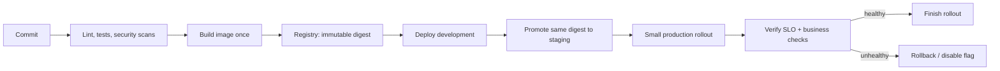
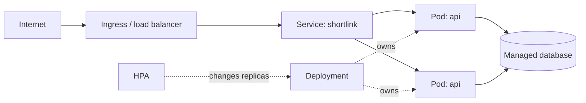

# 08 — Deployment, Cloud and Platform Engineering Lab

This chapter is a safe, repeatable deployment approach for multiple projects. It uses a small API as a concrete example, then shows how the same release artifact moves through development, staging, and production. Adapt provider-specific resource names, but keep the safety sequence.

## 1. The deployment goal

Deployment is the controlled promotion of a tested, immutable artifact plus compatible configuration and infrastructure. “The container started” is not success. Success means the release is reachable, healthy, observable, secure, within SLO, and safely reversible.



The pipeline should promote an image digest such as `sha256:...`, not rebuild a mutable `latest` tag for each environment. A tag is convenient for humans; a digest identifies exact bytes.

## 2. First project: containerized API

This illustrative Python API has one health endpoint. In a real project, pin dependencies, add tests, and avoid returning internal errors to clients.

```python
# app.py
from fastapi import FastAPI
from pydantic import BaseModel, Field

app = FastAPI()

class ShortLink(BaseModel):
    destination: str = Field(min_length=8, max_length=2048)

@app.get("/healthz")
def healthz():
    return {"status": "ok"}

@app.post("/v1/links", status_code=201)
def create_link(link: ShortLink):
    return {"code": "abc123", "destination": link.destination}
```

Line-by-line:

1. `FastAPI` creates the HTTP application; `BaseModel` declares validated request data.
2. The `app` object is the server entry point.
3. `ShortLink` specifies the accepted body. `Field` rejects too-short/too-long values before domain logic runs.
4. `/healthz` is a cheap process check. Do not make it depend on every remote service.
5. The create endpoint returns `201` because it created a resource. The code is a placeholder—production code would use a durable ID, authentication, database transaction, validation of allowed URL schemes, idempotency, and metrics.

### Dockerfile

```dockerfile
# syntax=docker/dockerfile:1
FROM python:3.12-slim AS runtime
WORKDIR /app
COPY requirements.txt .
RUN pip install --no-cache-dir -r requirements.txt
COPY app.py .
RUN useradd --create-home --uid 10001 appuser
USER 10001
EXPOSE 8080
CMD ["uvicorn", "app:app", "--host", "0.0.0.0", "--port", "8080"]
```

1. The first comment enables a modern Dockerfile syntax parser.
2. A small, pinned runtime base reduces surface area; in production pin by digest too.
3. `WORKDIR` makes following relative paths predictable.
4. Copy dependency manifest before source: Docker can reuse the dependency layer when only source changes.
5. Install without a pip cache so the resulting image is smaller.
6. Copy only required source. A `.dockerignore` should exclude `.git`, tests/artifacts as appropriate, and local secrets.
7. Create an unprivileged user; do not run the application as root.
8. `USER` applies that identity to subsequent runtime process.
9. `EXPOSE` documents intended port; it does not publish a firewall port.
10. `CMD` uses exec JSON form so signals (termination) reach the server process.

Build and run locally:

```powershell
docker build -t shortlink:dev .
docker run --rm -p 8080:8080 shortlink:dev
Invoke-WebRequest http://localhost:8080/healthz
```

Before you publish an image, scan dependencies and image layers, generate a software bill of materials where policy requires it, and fail builds for critical exploitable vulnerabilities according to a defined process. Do not put `.env` or credentials into the image.

## 3. Multi-container development with Docker Compose

Compose is useful for a reproducible local topology, not a production orchestration replacement.

```yaml
# compose.yaml
services:
  api:
    build: .
    ports: ["8080:8080"]
    environment:
      DATABASE_URL: postgresql://app:dev-only-password@db:5432/shortlink
    depends_on:
      db:
        condition: service_healthy
  db:
    image: postgres:16
    environment:
      POSTGRES_USER: app
      POSTGRES_PASSWORD: dev-only-password
      POSTGRES_DB: shortlink
    healthcheck:
      test: ["CMD-SHELL", "pg_isready -U app -d shortlink"]
      interval: 5s
      timeout: 3s
      retries: 10
```

Read it carefully:

- `api` is built from the local Dockerfile and maps the host’s port 8080 only for development.
- `DATABASE_URL` uses Compose service DNS name `db`; it is intentionally marked dev-only. Production gets a secret reference, not plaintext YAML.
- `depends_on` coordinates startup, but application code still needs retry/readiness because a database can become unavailable after startup.
- `db` is a disposable development database; production needs persistent, encrypted, backed-up storage and access controls.
- A health check reports whether Postgres accepts connections. It does not prove schema migrations or application business readiness.

Run `docker compose up --build`, make a request, then `docker compose down`. Add a named volume only when you want local data to persist.

## 4. Kubernetes: desired state and core objects

Kubernetes schedules containers as Pods. A **Deployment** declares a replicated, rolling-updatable set of Pods. A **Service** gives selected Pods a stable virtual address. An **Ingress** (or Gateway API) brings HTTP traffic in. ConfigMaps hold non-secret configuration; Secrets refer to sensitive values but still require encryption/RBAC/external-secret practices. HPA changes replica count based on a metric.



### Kubernetes Deployment example

```yaml
apiVersion: apps/v1
kind: Deployment
metadata:
  name: shortlink-api
  labels: {app: shortlink-api}
spec:
  replicas: 3
  strategy:
    type: RollingUpdate
    rollingUpdate: {maxUnavailable: 0, maxSurge: 1}
  selector:
    matchLabels: {app: shortlink-api}
  template:
    metadata:
      labels: {app: shortlink-api}
    spec:
      serviceAccountName: shortlink-api
      containers:
        - name: api
          image: registry.example/shortlink@sha256:REPLACE_WITH_DIGEST
          ports: [{containerPort: 8080}]
          env:
            - name: LOG_LEVEL
              value: "info"
            - name: DATABASE_PASSWORD
              valueFrom:
                secretKeyRef: {name: shortlink-db, key: password}
          resources:
            requests: {cpu: "250m", memory: "256Mi"}
            limits: {cpu: "1", memory: "512Mi"}
          startupProbe:
            httpGet: {path: /healthz, port: 8080}
            failureThreshold: 30
            periodSeconds: 2
          readinessProbe:
            httpGet: {path: /healthz, port: 8080}
            periodSeconds: 5
          livenessProbe:
            httpGet: {path: /healthz, port: 8080}
            periodSeconds: 10
          securityContext:
            allowPrivilegeEscalation: false
            readOnlyRootFilesystem: true
            runAsNonRoot: true
            capabilities: {drop: ["ALL"]}
```

Key details:

1. Three replicas let one fail or be updated while the service remains available, assuming capacity/headroom.
2. `maxUnavailable: 0` protects availability; `maxSurge: 1` creates one extra pod during rollout. Capacity must accommodate the surge.
3. The selector and pod labels must match exactly; mismatch leaves a Deployment with no Pods.
4. The image digest is immutable. Admission policy can reject mutable tags.
5. Secret values are projected at runtime. Kubernetes Secrets are base64-encoded, not automatically secure; restrict RBAC, enable encryption at rest, and preferably integrate an external secret manager.
6. Requests drive scheduling; limits prevent one container consuming all node capacity. Tune from measurements, not guesses.
7. A startup probe protects slow boot. Readiness controls traffic. Liveness should only restart a deadlocked/unrecoverable process, not react to a temporary database outage.
8. The security context removes common privileges. Test that the image actually can write only its intended temporary paths.

Add stable networking and scaling:

```yaml
apiVersion: v1
kind: Service
metadata: {name: shortlink-api}
spec:
  selector: {app: shortlink-api}
  ports: [{port: 80, targetPort: 8080}]
---
apiVersion: autoscaling/v2
kind: HorizontalPodAutoscaler
metadata: {name: shortlink-api}
spec:
  scaleTargetRef: {apiVersion: apps/v1, kind: Deployment, name: shortlink-api}
  minReplicas: 3
  maxReplicas: 20
  metrics:
    - type: Resource
      resource: {name: cpu, target: {type: Utilization, averageUtilization: 65}}
```

CPU HPA is an imperfect proxy. Queue depth/age may be better for workers; request rate or concurrency may be better for APIs. Autoscaling cannot repair a slow database or a hot key. Pair it with resource quotas, disruption budgets, topology spread/anti-affinity, and capacity planning.

## 5. Config, secrets, migrations and releases

Separate code from configuration: image digest stays the same across environments, while allowed origins, endpoints, feature flags, and replica policy vary. Validate configuration at startup and record a non-secret config/version fingerprint in logs.

Database migration is part of deployment. Use expand–migrate–contract:

1. Deploy compatible schema first (new nullable/additive structure).
2. Deploy code that understands old and new forms.
3. Backfill in throttled, resumable jobs; measure lag/errors.
4. Switch reads/writes after verification.
5. Remove old structure only after all old versions are gone and retention permits.

Never deploy a destructive migration with no tested backup/restore and no compatible rollback path. A binary rollback cannot always undo data transformation; feature flags and forward fixes may be safer.

## 6. CI/CD pipeline with policy gates

An implementation-neutral pipeline:

```yaml
stages:
  - validate: format, lint, unit tests, dependency checks
  - test: integration tests with ephemeral dependencies, contract tests
  - package: build image once, SBOM/sign/scan, push immutable digest
  - deploy-dev: apply IaC/manifests, smoke test
  - promote-stage: deploy same digest, migration rehearsal, load/contract tests
  - approve-prod: change evidence and human approval if required
  - progressive-prod: canary, automated metric analysis, full rollout or rollback
  - verify: synthetic journey, SLO/business/queue/trace checks, release annotation
```

The exact CI vendor syntax is less important than controls: protected production credentials, least privilege, reviewed changes, no long-lived personal tokens, immutable artifact provenance, environment separation, and auditable approval/rollback history.

## 7. Infrastructure as Code (IaC)

IaC declares networks, identity, compute, storage, databases, monitoring, and policy in versioned code. Terraform commonly plans a desired state then applies changes through a state backend. Its state can contain sensitive identifiers or outputs; encrypt it, restrict access, lock it against concurrent applies, and never commit it casually.

```hcl
# Illustrative Terraform: provider and remote state configuration omitted intentionally.
resource "example_network" "app" {
  name = "shortlink-production"
  cidr = "10.20.0.0/16"
}

resource "example_database" "orders" {
  name              = "shortlink"
  network_id        = example_network.app.id
  multi_zone        = true
  backup_retention  = 14
  encryption_at_rest = true
}
```

This declares intent, not imperatively “click these console buttons.” A real module also restricts ingress/egress, assigns service identities, enables audit logs, alarms, backups, and tagged ownership. Review `plan` output carefully: an innocuous field can force replacement of a production resource.

## 8. Deployment strategies and when to choose them

| Strategy | How it works | Strength | Risk/control |
|---|---|---|---|
| Recreate | stop old, start new | simple | downtime; rarely suitable |
| Rolling | replace instances gradually | efficient/default | mixed versions must be compatible |
| Blue-green | two full environments; switch traffic | near-instant rollback | double capacity, migration compatibility |
| Canary | send small % to new version first | limits blast radius | needs reliable traffic split/metric analysis |
| Shadow | copy request to new version, ignore response | test production-like load | protect PII/side effects; output comparison needed |

### Production canary runbook

1. Confirm image digest, manifests, migration compatibility, on-call owner, rollback command, dashboards, and baseline SLO.
2. Deploy new version with zero/low traffic; verify readiness, config, logs, and a synthetic request.
3. Shift 1% traffic (or a safe internal tenant). Watch errors, p50/p95/p99, saturation, business success, and downstream errors for a predeclared window.
4. Shift 5%, 25%, 50%, then 100% only if each gate passes. Do not rely on a single average latency metric.
5. Roll back immediately if an abort threshold is crossed. Preserve diagnostic artifacts; do not keep increasing traffic “to see.”
6. After 100%, watch for queue backlog, scheduled work, and delayed effects. Record release metadata on dashboards.

## 9. Serverless, mesh, and tenancy

**Serverless functions** scale on events and remove server management for suitable short-lived workloads. Design for cold starts, execution/time/memory limits, concurrency bursts, retries, idempotency, and connection reuse. They are often good event workers and small APIs; they are not automatically cheaper under steady high load.

A **service mesh** may provide workload identity/mTLS, traffic policy, retries, and telemetry through proxies/control plane. It can standardize policy, but adds latency, resources, failure modes, and operational expertise. Do not use mesh retries without application deadlines and idempotency.

Multi-tenant systems need deliberate isolation: tenant-scoped authorization in every query, scoped cache keys, quotas, noisy-neighbor protection, audit trails, encryption/key strategy, and deletion/export workflow. A shared database with tenant ID is common initially; separate schemas/databases/accounts improve isolation but raise management complexity.

## 10. Three concrete project deployment paths

### Project A: URL shortener (small, read-heavy)

1. Package stateless API in container; use managed SQL as source of truth.
2. Development uses Compose; staging/prod use managed database and objectless small payloads.
3. Deploy API as Kubernetes Deployment behind CDN/WAF/Ingress.
4. Add Redis cache-aside only after measuring read load; expire/invalidate when links change.
5. Canary API code. Use expand–migrate–contract for schema changes. Backup and restore drill SQL data.

### Project B: media upload service (large files, async work)

1. Browser asks API for short-lived signed multipart-upload URL; bytes go directly to object storage, not through API pods.
2. Object-created event queues a virus scan/transcode worker; the worker is idempotent by object/version ID.
3. API stores metadata/status; CDN serves completed public/authorized variants.
4. Scale workers by queue age/depth; cap concurrency so a burst does not exhaust transcode capacity.
5. Lifecycle old originals/variants intentionally and validate signed URL, content type/size, malware policy, and tenant prefix.

### Project C: order service plus notification worker (multi-project deployment)

1. Independently build `orders-api` and `notifications-worker`; each has a separate repository/pipeline, owner, SLO, and deploy manifest.
2. `orders-api` commits order and outbox event in one transaction. A relay sends an `OrderPaid` contract to a shared event topic.
3. Deploy event schema changes additively, first supporting new consumers, then producers. Do not coordinate releases by changing a required field in one jump.
4. Deploy worker separately, observe consumer lag/DLQ/notification success, and roll it back without rolling back the order service.
5. Version contracts and test them in CI. The event topic is a production dependency with retention, access policy, quotas, and on-call ownership.

## 11. Pre-production and post-deployment checklist

Before: threat model, tests, image digest/signature, scanned dependencies, resource requests, quota, secret references, least-privilege identity, health probes, dashboards/alerts, backup/migration plan, rollout/rollback owner.

After: endpoint/synthetic health, error/latency baseline, logs with release version, traces, database migration state, cache/queue health, business conversion/success, resource saturation, security audit events, and rollback readiness. If one cannot be checked, deployment is not yet verified.
