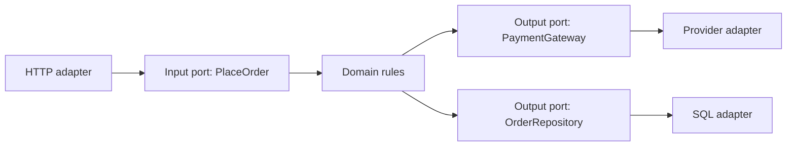
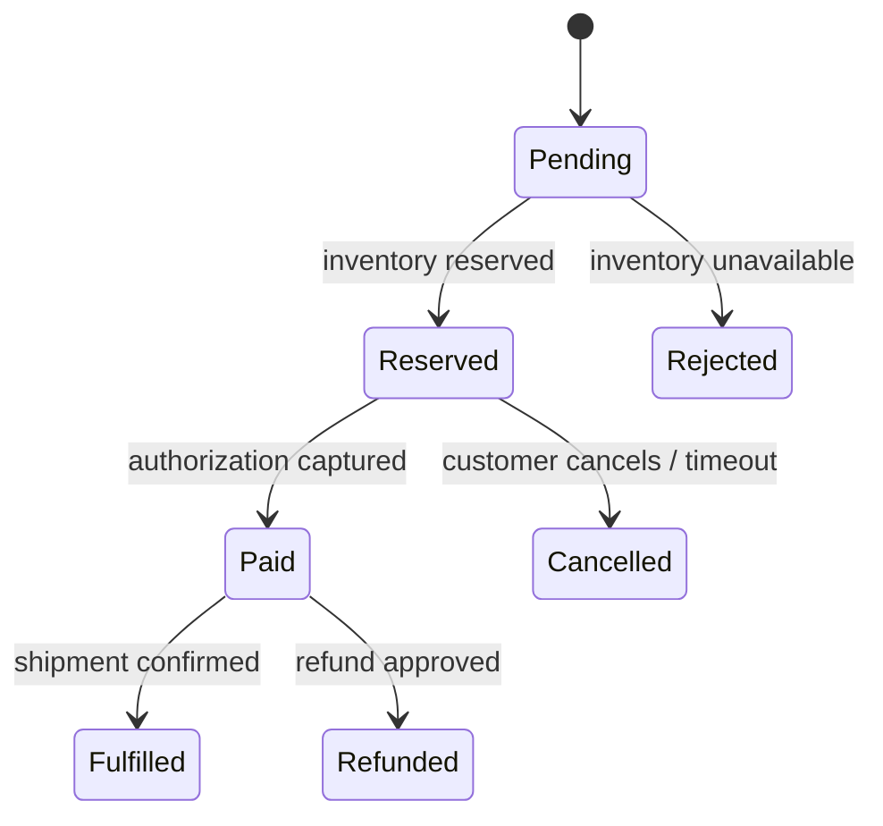

# 09 — Advanced Architecture Patterns and Specialist Systems

## 1. Domain-driven design (DDD)

DDD starts with the business language, not the database table. A **bounded context** is an area where a word has one precise meaning. “Customer” in billing (legal payer) may differ from “customer” in support (person contacting help). Each context owns its model and contract; forcing one giant shared model causes accidental coupling.

An **aggregate** is a small consistency boundary with one entry point (aggregate root). For example, an Order aggregate may protect “cannot pay a cancelled order.” Keep aggregates small; do not load an entire customer history to change one address. Cross-aggregate workflows usually use events/sagas rather than one giant transaction.

An **anti-corruption layer** translates between an external/legacy model and your domain model. It prevents terms, IDs, states, and quirks of a payment provider or old monolith from leaking everywhere.

## 2. Clean and hexagonal architecture

Clean/hexagonal architecture places domain rules at the center. **Ports** are interfaces the domain needs (payment authorization, repository, clock); **adapters** implement them for HTTP, SQL, queues, or external providers. The dependency direction points inward: business logic does not import a web framework or database driver.

This improves testability and replacement, but abstractions that merely mirror every database method add ceremony. Create a port where business logic needs a stable capability or an external boundary.

## 3. Strangler migration from monolith

The strangler fig pattern incrementally replaces part of a monolith. Put a routing façade in front, route one capability to a new service, synchronize/migrate data carefully, then retire old paths. Start with a low-risk, clearly bounded capability rather than the central checkout transaction.

Migration steps:

1. Map current behavior, data ownership, clients, batch jobs, and hidden dependencies.
2. Define new contract and source of truth; add observability/contract tests.
3. Route a small read-only capability or shadow traffic to the new path.
4. Move writes with dual-read/dual-write only for a short, verified phase—or use change capture/outbox.
5. Reconcile data, gradually shift traffic, then remove old code/data access.

Dual writes are temporary and risky because partial failure creates divergence. Use one authority per fact and plan reconciliation from the beginning.

## 4. Workflows and state machines

Model business processes explicitly: states, valid transitions, timeout, retry, compensation, and owner. A state machine makes invalid actions impossible to accidentally implement.

Persist state transitions with an idempotency key/audit event. A workflow orchestrator is useful when operations last minutes/days, wait for humans, need durable timers, or coordinate multiple services. For a simple short local operation, a database transaction is clearer.

## 5. Data mesh, lakehouse and analytical ownership

Data mesh is an organizational approach: domains own data as products with discoverable contracts, quality, governance, and interoperable access. It is not “every team gets a data lake.” A data lake stores inexpensive raw/curated data; a lakehouse adds warehouse-like table management, transactions/metadata, and compute patterns on lake storage. Establish data classification, lineage, retention, access policy, quality SLOs, and cost ownership before distributing responsibility.

## 6. Multi-tenant SaaS design

Common models:

| Model | Isolation | Operations | Good fit |
|---|---|---|---|
| shared DB, shared tables + tenant key | logical | simplest | many small tenants |
| shared DB, schema per tenant | stronger logical | migrations multiply | moderate tenant count |
| database per tenant | strong | expensive to manage | high-value/regulatory tenants |
| account/cluster per tenant | strongest blast-radius isolation | highest cost | strict enterprise needs |

Even with a tenant key, enforce authorization at the service and ideally database row-policy layer, scope cache/search/object paths, use tenant quotas, prevent noisy neighbors, and audit privileged support access. “Tenant ID from request body” is not a boundary.

## 7. Feature flags, experimentation and A/B tests

A release flag controls availability; an experiment assigns comparable populations to variants. Define hypothesis, primary metric, guardrail metrics, allocation, duration, statistical method, exposure logging, and stop criteria before launching. Randomize consistently (for example hash of user ID) and respect consent/privacy. Do not equate a short-lived metric bump with causal proof when sample selection or seasonality changed.

Flags require a fail-safe default, permissioned changes, audit log, targeting constraints, and expiry/removal. Test both flag paths; long-lived flags create an exponential configuration space.

## 8. Search, ranking, recommendations and feed fan-out

Search pipeline: ingest → parse/normalize → index → retrieve candidates → filter permissions → rank → paginate/log feedback. Use an inverted index for lexical search and optionally vector retrieval for semantic candidates. Evaluate relevance with judged queries and online guardrails; do not depend only on click-through rate, which can be biased.

Recommendation commonly separates offline feature/model training from online candidate retrieval/ranking. Protect latency with a fallback: trending/recent items is better than blocking a home page while a model store fails. Exclude already seen/unavailable/unauthorized items.

For social feeds:

- **Fan-out on write:** write a post reference to follower inboxes. Fast reads, expensive celebrity post fan-out.
- **Fan-out on read:** build from followed authors at read time. Cheap writes, expensive reads.
- **Hybrid:** precompute ordinary accounts; fetch celebrity content on read.

Store immutable post records separately from feed pointers. A deleted/blocked post must be filtered at read time or invalidated from materialized feeds.

## 9. Geo, media and real-time collaboration

**Geospatial indexing:** geohash, quadtrees and Hilbert curves map location to sortable buckets. They support nearby queries by searching a cell plus neighbors, then computing exact distance. Cell boundaries, poles, density, and privacy matter; never expose precise user location unnecessarily.

**Media pipeline:** client receives signed multipart upload capability → stores original → validation/virus scan → transcode worker generates variants → status metadata → CDN delivery. Make processing idempotent by object version; cap duration/resolution; keep originals/derivatives under lifecycle policy; restrict access with signed URLs/cookies.

**Collaboration:** operational transformation (OT) transforms concurrent edits against a central ordered history; CRDTs make operations merge under mathematically designed rules and can support offline work. Both require document model, permission, operation validation, snapshots/compaction, presence separation, and UX for conflicts. “WebSocket” transports operations; it does not solve concurrent edit semantics.

## 10. Payment, trading and booking correctness patterns

Payments use immutable, double-entry ledger entries: every debit has a corresponding credit, amounts use integer minor units, and external provider IDs/idempotency keys are recorded. Do not overwrite money history; post correcting entries. Reconcile provider settlements against internal ledger and investigate unmatched records.

Ticket booking needs a short-lived reservation transaction with an expiry. The constraint that one seat has at most one active reservation should be enforced in the database/coordination layer. Present availability can be approximate, but final reservation needs strong protection.

Order matching/trading systems need well-defined price-time priority, durable ordered commands, risk checks, idempotent client order IDs, auditable event history, and careful recovery. These are specialist systems—use proven designs and regulation/compliance expertise rather than generic CRUD patterns.

## 11. When patterns hurt

Every pattern buys one capability and adds cost. CQRS adds replica lag; microservices add network failure; event sourcing adds event evolution; a mesh adds control-plane complexity; active-active adds conflict resolution. Add a pattern only with a written problem statement, owner, success metric, operational runbook, and exit condition.
