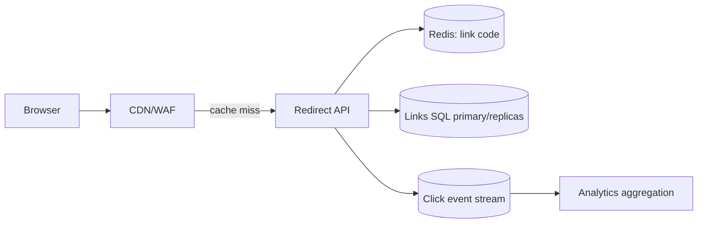

# 10 — End-to-End System Design Practice

Use every exercise with the standard answer order in the README: scope, requirements, estimates, API/data model, simple HLD, scale, failure/security, operations, trade-offs. The designs below are deliberately outlines—your practice is to fill the numbers and justify each added component.

## 1. Fully worked example: URL shortener

### Scope and targets

Create a short link, redirect it, optional expiry/custom alias, basic click count. Assume 10 million new links/month, 100:1 redirect:create ratio, global redirects, p99 redirect under 100 ms, and no loss of an acknowledged link. Analytics may be eventually consistent.

### Estimate

`10M / 30 / 86,400 ≈ 3.9 writes/s average`; at 10× peak, about 40 writes/s. Redirects average roughly 390 RPS and peak 3,900 RPS. If one row averages 500 bytes plus indexes, one year raw links are about 60 GB before replicas/backups; this fits a relational primary initially. The high read ratio suggests CDN/Redis cache.

### APIs and data

```text
POST /v1/links                 body: {destination, customCode?, expiresAt?}
GET  /{code}                   returns 302/307 redirect or a branded expired page
GET  /v1/links/{code}/stats    authenticated owner analytics
DELETE /v1/links/{code}        authenticated revoke
```

Table: `links(code PK, owner_id, destination, created_at, expires_at, disabled_at)`. A unique primary key protects aliases. Validate URL scheme, block dangerous/private targets as policy requires, rate-limit creation, and use idempotency keys for POST.



### Flow and trade-offs

Redirect service checks disabled/expiry correctly. Cache hit returns redirect; miss reads SQL and fills cache with TTL bounded by link expiry. Publish click event asynchronously so analytics cannot slow redirect. Cache analytics separately, because individual click events are high volume. An initially SQL-only implementation is valid; add cache after a load test confirms read pressure. For global low latency, route redirects to regional caches/read replicas while ensuring create/read-your-writes behavior for the owner dashboard.

Failures: cache outage falls back to database with rate protection; database outage may serve a short stale cached redirect only if policy permits, otherwise error; queue outage may drop noncritical analytics or buffer it explicitly—do not claim durable click analytics without a durable ingestion path. Dashboard: redirect rate/error/p99, cache hit, DB connections, queue lag, expired/revoked redirect count.

## 2. Core practice set

| System | Core entities/API | First architecture | Scale/correctness lesson |
|---|---|---|---|
| Pastebin | paste, expiry, visibility | API + object/text store + metadata DB | cache popular pastes; abuse and TTL deletion |
| Rate limiter | key, policy, token count | gateway + atomic distributed counter | token bucket, consistent key routing, fail-open/closed policy |
| API gateway | routes, client identity, policy | edge proxy + config store | auth/rate limit/observability; avoid business-logic monolith |
| Web crawler | URL frontier, fetch result, robots state | queue + fetch workers + storage | politeness per host, dedupe canonical URLs, backpressure |
| File/object service | metadata, object, upload session | API + object store + signed URLs | multipart upload, checksum, lifecycle, authorization |
| Notification system | notification, preference, delivery attempt | outbox + topic + channel workers | idempotency, retries, provider failover, DLQ |
| Distributed cache | key/value, TTL, node ring | cache nodes + client/router | consistent hashing, replicas, eviction, hot keys |
| Metrics/log platform | sample/log, tenant, time range | ingestion queue + time-series/object store | high cardinality, retention, query fan-out |
| Job scheduler/cron | job, schedule, run, lease | scheduler + durable DB + worker queue | missed run policy, leader/fencing, idempotent jobs |
| Feature-flag platform | flag, targeting rule, evaluation | config API + SDK cache + audit log | low-latency local evaluation, safe defaults, propagation |

### Web crawler progression

Start with a URL queue and fetch worker. Normalize URLs, store a visited fingerprint, respect `robots.txt`, set per-host rate limits, timeouts, response size caps, and content-type filtering. At scale, partition frontier by host so one site cannot monopolize workers; persist crawl state and retry transient fetches. Crawling legal/ethical policy, user-agent identity, and opt-outs are requirements—not extras.

### Rate limiter progression

For a single API node, an in-memory token bucket works. For many nodes, use an atomic centralized store or route each identity to an owner shard. Track `(identity, rule)` state with refill timestamp/token count; return `429` and headers. Decide strictness during limiter outage: public abuse-sensitive endpoint may fail closed, while an internal read endpoint may fail open with an alert. Never let an attacker choose arbitrary high-cardinality limiter keys.

## 3. Consumer/product systems

| System | Data/flow to emphasize | Hard part |
|---|---|---|
| Chat/messaging | conversation, message sequence, delivery/read receipt | per-conversation ordering, offline sync, idempotent send |
| Presence service | heartbeat, user/device presence TTL | approximate truth, reconnects, fan-out hot users |
| News/Instagram feed | post, follow edge, feed pointer | fan-out write/read hybrid, ranking, celebrity hot spot |
| Search autocomplete | query prefix, frequency, locale | trie/FST or search index, freshness, abuse/privacy |
| E-commerce marketplace/cart/order/inventory | product, cart, order, reservation | checkout saga, stock reservation, price snapshot |
| Food delivery | order, restaurant, courier location, status | dispatch matching, live updates, geospatial search |
| Ride-sharing | driver location, trip, dispatch | nearby driver index, assignment race, ETA and surge |
| Maps/location tracking | location update, map tile, route | high-rate geo ingest, privacy, map/tile provider split |
| Social-network timeline | post, follow, visibility | blocks/privacy filtering and materialized timeline repair |
| Email service | mailbox, message, attachment, send attempt | storage/retention, spam/abuse, delivery/retry |

### Chat example API and model

```text
POST /v1/conversations/{id}/messages  {clientMessageId, body}
GET  /v1/conversations/{id}/messages?cursor=...
WS   /v1/realtime                     receive message/delivery events
```

Store `message_id`, `conversation_id`, `sender_id`, monotonically assigned conversation sequence, body/reference, created time, and client idempotency ID. Partition stream by conversation ID for ordered delivery. The sender’s client retries with same `clientMessageId`; server returns the original message. WebSocket is delivery optimization; historical catch-up comes from durable storage. Encrypt transport, authorize conversation membership per operation, and set retention/deletion policy.

### Marketplace checkout flow

1. Cart is mutable convenience data; order captures price/address/tax snapshot.
2. Checkout creates pending order with idempotency key.
3. Inventory service reserves units with expiry under a strong constraint.
4. Payment authorization/capture runs with provider idempotency key.
5. Saga confirms order or compensates reservation/payment based on state.
6. Outbox emits `OrderPaid`; fulfillment/notification consumers act asynchronously.
7. Reconcile payment provider reports and inventory reservations; show status to customer, never guess after ambiguous timeout.

## 4. Content, media, collaboration and cloud drives

| System | v1 | Advanced direction |
|---|---|---|
| Video streaming | upload metadata + object store + CDN | async transcode ladders, DRM/entitlement, adaptive bitrate, analytics |
| YouTube upload/transcoding | signed multipart upload + job state | checksum/resume, virus scan, queue priority, retries/DLQ, variants |
| Netflix-style recommendation | catalog + simple trending endpoint | event collection, features, offline training, candidate/rank service fallback |
| Reels/TikTok feed | chronological/video metadata | personalized ranking, prefetch, creator fan-out, moderation, CDN |
| Zoom/WebRTC call | signaling service + WebRTC peers | SFU, TURN, rooms, quality telemetry, recording consent |
| Google Docs editor | document CRUD | OT/CRDT operation log, snapshots, presence, permissions, offline sync |
| Cloud drive | file metadata + signed object upload | folder ACLs, dedupe, versioning, sync conflict algorithm |
| Dropbox sync | device change journal | block-level hashes, delta transfer, conflict copies, efficient reconciliation |

For media, split control plane (authorization, metadata, job status) from data plane (large file bytes directly to object store/CDN). For video calls, signaling exchanges SDP/ICE information; STUN discovers address candidates; TURN relays when peer connectivity fails; an SFU forwards selected streams for multi-party scalability. Never promise end-to-end encryption without a design that preserves it through any recording/transcription/SFU requirements.

## 5. Financial, booking and high-integrity systems

| System | Invariants | Architecture notes |
|---|---|---|
| Payment system/wallet | ledger balances derive from balanced entries; no double charge | idempotency, provider reconciliation, immutable audit, strong write path |
| Ticket booking | one active reservation/seat | transactional reservation/expiry, queue/waiting room, no cache as final authority |
| Stock trading/order matching | deterministic price-time priority; risk limits | ordered command log, matching engine partition, durable event/audit/recovery |
| Multi-region payment/booking | no duplicate irreversible outcome | regional routing, idempotency, saga/reconciliation, explicit failover mode |

High-integrity systems need a clear state machine, immutable audit history, controlled manual correction, separation of duties, reconciliation jobs, and tested disaster recovery. “Exactly once” is not a substitute for ledger design and operational investigation.

## 6. Search, analytics and data platforms

### Search engine

Ingest documents asynchronously, parse/tokenize, build inverted index, replicate shards, retrieve candidates, filter ACL/tenant, rank, return cursor page, and collect safe relevance feedback. Shard by document ID; replicate for availability; route queries to replicas; use incremental indexing plus periodic rebuild. Manage deletions, synonym/analyzer versions, reindex migrations, and index lag visibility.

### Ad click tracking and analytics

Click ingestion needs high throughput, an event ID, timestamp, campaign/ad identifiers, privacy-consent state, coarse client context, and bot/fraud signals. Append events to a durable stream; dedupe/validate; aggregate in windows; store raw immutable events with retention; provide delayed dashboards. Do not issue billing based solely on unverified client events. Track late events, correction records, and data quality.

### Metrics/logging platform

Accept batched compressed writes, authenticate/limit by tenant, buffer in partitions, index labels/timestamps, persist chunks to durable object storage, and execute bounded queries. Guard against high-cardinality labels, enormous time ranges, regex abuse, and a single noisy tenant. Retention/downsampling tiers control cost.

## 7. A design exercise template

Copy this into a blank document for every new problem:

```text
Problem / scope:
Users and core actions:
Out of scope for v1:
Functional requirements:
Non-functional targets (p99, availability, durability, consistency, regions):
Assumptions and estimates (RPS, peak, storage, bandwidth, concurrency):
API contracts and idempotency:
Entities, source of truth, indexes:
HLD and request/event flows:
Caching / queues / partitioning / replicas:
Failure cases and recovery:
Security, privacy, abuse controls:
Metrics, SLI/SLO, alerts, runbook:
Cost/scaling trade-offs:
What v1 builds; what triggers the next iteration:
```

Practice by explaining one design aloud in 45 minutes, then load-test or prototype the smallest risky part. A finished diagram without a failure story is not a finished design.
