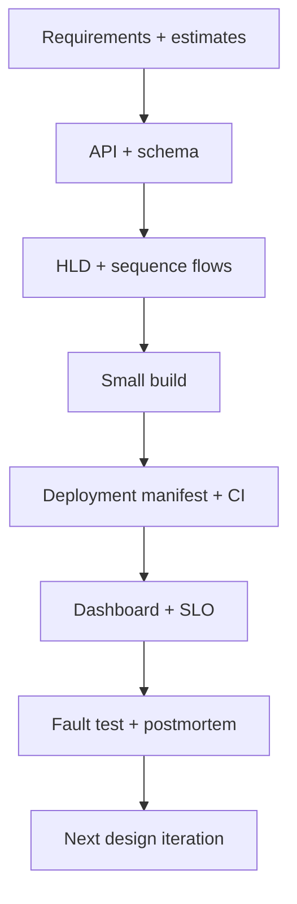

# 11 — Interview Method, Mastery Checklist and 24-Week Plan

## 1. What mastery looks like

For any design problem, mastery means you can explain—not merely name—the following:

1. Users, scope, assumptions, functional and non-functional requirements.
2. Peak QPS/RPS, storage, bandwidth, concurrency, and growth with units.
3. APIs, error/idempotency behavior, entities, schema, and indexes.
4. A component diagram plus normal request/data flow.
5. Why a database/cache/queue/partition strategy fits the access pattern.
6. Exact consistency and durability guarantees, including where they stop.
7. Duplicate, timeout, dependency, deployment, and region-failure handling.
8. Authentication, authorization, tenant isolation, privacy, abuse controls, and audit trail.
9. Metrics, SLI/SLO, alerts, runbook, backups, restore/failover plan, and cost drivers.
10. What v1 actually builds, what is deliberately postponed, and what signal triggers the next stage.

The best answer is not the most components. It is a coherent sequence from product promise to operational proof.

## 2. 45–60 minute interview outline

| Minute | Do | Output |
|---:|---|---|
| 0–5 | clarify scope and success | requirements / exclusions |
| 5–10 | state assumptions and estimate | peak RPS, storage, key ratios |
| 10–18 | API and data model | endpoints, entities, invariants/indexes |
| 18–33 | draw simple HLD and flow | synchronous path and async path |
| 33–43 | scale and data strategy | cache, replicas, partitions, queue |
| 43–53 | failures/security/operations | retry/idempotency, SLO, backup, auth |
| 53–60 | trade-offs and evolution | v1 vs later, questions |

Speak in hypotheses: “I assume redirect reads can be stale for 60 seconds; if custom aliases must become visible globally immediately, I would change the routing/cache contract.” This shows you understand requirements cause architecture.

## 3. Communication habits that make designs clear

- Start with a simple version. Add each component only after naming the load, failure, or ownership problem it solves.
- Label arrows with protocol and data. Mark asynchronous paths and source of truth.
- State a guarantee precisely: “at-least-once event delivery plus idempotent consumer,” not “exactly once.”
- Separate user critical path from eventual analytics/notifications.
- Say the downside of your choice and the alternative you rejected.
- Correct your estimate without embarrassment when a new requirement changes it.
- Ask about compliance/privacy/regions early when they materially change data placement.

## 4. Capacity estimation drills

### Drill A: daily activity to peak rate

If 50 million requests/day and peak is 8× average:

```text
average RPS = 50,000,000 / 86,400 ≈ 579
peak RPS    ≈ 4,632
```

If cache hit rate is 95%, database read peak is `4,632 × 0.05 ≈ 232 RPS`, before background/admin traffic. Do not use cache hit rate to reduce write capacity; writes still reach the authoritative store.

### Drill B: queue recovery

Workers handle 200 jobs/s normally. An upstream burst creates 3 million jobs. To clear in 30 minutes while new traffic is 100 jobs/s:

```text
required total rate = 3,000,000 / 1,800 + 100 ≈ 1,767 jobs/s
extra capacity       ≈ 1,567 jobs/s
```

You need enough workers/partitions/provider quotas and downstream capacity. Scaling a consumer that is blocked on one database connection will not reach the mathematical rate.

### Drill C: availability budget

For 99.95% availability in a 30-day month:

```text
allowed failure = 43,200 minutes × 0.0005 = 21.6 minutes
```

Define what counts: only valid user requests, planned maintenance, dependency-caused user failure, and partial-region effects should match the SLO policy.

## 5. A 24-week build-first curriculum

Assume 6–10 focused hours weekly. Keep a design notebook and repository per project. Read the related chapter before building, then return to it during the postmortem.

| Weeks | Focus | Build/output |
|---|---|---|
| 1–2 | foundations, requirements, estimates, HTTP | one-page URL shortener HLD, API and SQL schema |
| 3–4 | networking, REST, auth | working URL shortener with validated API and tests |
| 5–6 | SQL/indexes/cache | add measured cache-aside, cursor listing, migration/revert drill |
| 7–8 | queues/idempotency | notification service with outbox, retries and DLQ |
| 9–10 | Docker/CI | containerize both projects, Compose dev environment, tests and image scan |
| 11–12 | Kubernetes/IaC | deploy to a non-production cluster, probes, HPA, dashboard, rollback rehearsal |
| 13–14 | distributed workflows | marketplace checkout state machine, inventory reservation and saga design |
| 15–16 | reliability | SLO, synthetic check, chaos experiment, restore/postmortem |
| 17–18 | media/search/realtime | signed upload pipeline or chat service with durable history |
| 19–20 | advanced patterns | migrate one module boundary, design CQRS/search projection or collaboration semantics |
| 21–22 | multi-region/cost/security | DR plan, threat model, tenant isolation and cost model |
| 23–24 | interview repetitions | six timed designs, revise weak areas from recordings/feedback |

Use the ordered material mentioned in the original outline as focused supplements: TechByAni for an ordered course, designKarle for capacity/scaling drills, Mayank Joshi for leader election/distributed locks, and Hayk Simonyan for API security. Watching is input; the project artifact and postmortem prove understanding.

## 6. Required artifacts for every project



Keep the following under version control:

- README with scope/run instructions and architecture diagram.
- OpenAPI/API examples and error/idempotency contract.
- Schema migrations, index rationale, seed data, and query-plan notes.
- Dockerfile, Compose file, IaC/manifests, deployment/rollback runbook.
- Tests: unit, integration, contract, and one load/failure test appropriate to risk.
- Dashboard screenshots/queries, SLI/SLO definition, alert routing.
- Threat model, access policy, secret/PII handling, backup/restore evidence.
- One blameless postmortem from an intentionally injected or discovered failure.

## 7. Design review scorecard

Score each area 0 (missing), 1 (named), 2 (explained/validated).

| Area | 0 | 1 | 2 |
|---|---|---|---|
| Requirements | vague | list present | measurable, scoped, prioritized |
| Estimates | none | one number | assumptions, peak, units, growth |
| Data | generic DB | schema named | constraints/indexes/source of truth |
| Scale | “use cache” | component listed | trigger, sizing, invalidation/partition plan |
| Failure | “retry” | timeouts listed | idempotency, fallback, recovery/chaos test |
| Security | “JWT” | auth named | object authorization, secrets, abuse/privacy |
| Operations | logs named | dashboard listed | SLO, alert, runbook, restore evidence |
| Trade-offs | none | pro/con | alternative tied to requirement |

Aim for 14+/16 before calling an exercise strong. A low score identifies exactly what to improve next.

## 8. Final pre-answer checklist

- Did I choose a source of truth and ensure cache/index/event copies can be rebuilt?
- Did I state what happens after client timeout, duplicate retry, and consumer replay?
- Did I keep each remote call on the critical path intentional and deadline-bound?
- Did I show capacity at peak and recovery, not only normal average?
- Did I separate availability from durability and consistency?
- Did I make tenant/user authorization part of each data access path?
- Did I define metrics that prove the user promise and a rollback condition?
- Did I describe a smaller v1 before naming advanced infrastructure?

If you can answer these calmly while drawing the flow, you have moved from memorizing systems to designing them.
