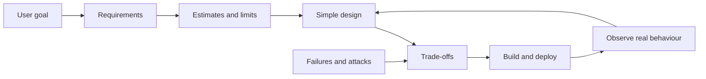

# System Design: A Practical Path from First Principles to Advanced Systems

This is a self-contained study guide and build lab. It starts with a single HTTP request and ends with multi-region, observable, secure systems. Read chapters in order once. Then use the projects and deployment labs to practise drawing, estimating, building, breaking, and explaining systems.

> **A useful promise:** system design is not choosing fashionable tools. It is repeatedly making a clear trade-off: *which guarantee matters for this user action, and what does it cost?*

## How to use this guide

For each topic, do four things:

1. Explain the problem in one sentence without product names.
2. Draw the request and data flow before selecting technology.
3. Estimate one peak number (requests, bytes, users, or jobs).
4. Name one failure, its user effect, and the recovery behaviour.

Do not try to memorize every pattern. First build a small, correct version; measure it; then add a component only when it removes a known bottleneck or risk.

## Reading order

| Part | What you learn | File |
|---|---|---|
| 1 | Vocabulary, requirements, capacity, architecture | [01 Foundations](01-foundations.md) |
| 2 | Internet request path and protocols | [02 Networking](02-networking.md) |
| 3 | APIs, resilience, security and service boundaries | [03 APIs and Security](03-apis-and-security.md) |
| 4 | SQL, NoSQL, indexes, storage and data scaling | [04 Data Systems](04-data-systems.md) |
| 5 | Distributed systems theory and reliable workflows | [05 Distributed Systems](05-distributed-systems.md) |
| 6 | Caches, queues, streams and event-driven design | [06 Caching and Messaging](06-caching-and-messaging.md) |
| 7 | Metrics, SLOs, incidents and disaster recovery | [07 Reliability and Operations](07-reliability-and-operations.md) |
| 8 | Docker, Kubernetes, IaC, CI/CD and deployments | [08 Deployment Lab](08-deployment-lab.md) |
| 9 | Advanced architectural patterns and specialist systems | [09 Advanced Patterns](09-advanced-patterns.md) |
| 10 | End-to-end design exercises with solution outlines | [10 Design Practice](10-design-practice.md) |
| 11 | Interview process, checklists and 24-week plan | [11 Mastery Plan](11-mastery-plan.md) |

## Runnable learning example

The [shortlink API example](examples/shortlink-api/README.md) is a deliberately small local service with validation, request IDs, durable local storage, expiry, and idempotent create requests. Its source is heavily commented; use it alongside the deployment lab before replacing its single-instance SQLite store with a production database.

## The mental model

The loop matters. A diagram is a hypothesis until production metrics or a load test tests it.

## The standard design answer

Use this order for every system-design question. It prevents a beautiful but irrelevant architecture.

1. **State scope.** What exact user action is in and out? For a first URL shortener, custom aliases and expiry may be in; analytics dashboards and ads may be out.
2. **List functional requirements.** Observable user behaviours: create a short URL, redirect it, expire it.
3. **Set non-functional targets.** Example: redirect p99 below 100 ms, 99.95% monthly availability, no lost links after acknowledgement.
4. **Estimate.** Peak reads/writes, data size, bandwidth and growth. Show assumptions.
5. **Draw v1.** Client, edge, service, primary data store. Keep it small.
6. **Define API and data model.** Include validation, error shape, authorization and idempotency where writes can be retried.
7. **Add scale.** Cache, replicas, partitions and asynchronous workers only for quantified pressure.
8. **Walk through failure paths.** Timeouts, duplicate messages, stale data, deployment rollback, regional loss.
9. **Add operations and security.** Dashboards, alerts, audit trail, secrets, backups, rate limits.
10. **Name trade-offs and next steps.** Strong consistency might cost availability or latency; a cache might serve stale reads.

## A compact vocabulary

| Term | Plain-English meaning |
|---|---|
| Latency | Time one operation takes. Report a percentile, not only the average. |
| Throughput | Work completed per unit time, such as requests/second. |
| Availability | Fraction of time a system successfully serves its promised function. |
| Durability | Whether an acknowledged write survives later failures. |
| Consistency | What different readers are allowed to observe after writes. |
| Scalability | Ability to meet more load by adding resources or improving efficiency. |
| Partition | A network split: some machines cannot reach others. |
| Replica | Another copy of data, used for availability, read capacity, or locality. |
| Shard | A subset of data owned by one of several database partitions. |
| Idempotent | Repeating an operation has the same intended result as doing it once. |

## A multi-project learning ladder

Build these in sequence. Every project reuses an earlier skill and introduces one new problem.

| Project | First version | Add next | What it teaches |
|---|---|---|---|
| URL shortener | API + SQL table | Redis + rate limit + cache invalidation | IDs, read-heavy design |
| Notification service | HTTP endpoint + worker | queue, retries, DLQ, provider failover | asynchronous reliability |
| Marketplace | catalog, cart, order | inventory reservation, saga, outbox | data boundaries |
| File service | upload metadata | object store, multipart upload, signed URLs | large data path |
| Collaborative notes | REST CRUD | WebSocket, operation log, conflict handling | real-time state |
| Payments ledger | wallet API | double-entry ledger, idempotency, reconciliation | correctness over convenience |

Each project must leave you with a one-page design, APIs, schema, deployment manifest, load test, dashboard, runbook, and a postmortem for one injected failure.

## Delivery principles used throughout

- Never deploy an untested, mutable artifact. Build once, identify it by immutable digest, and promote that same artifact.
- Treat infrastructure and configuration as reviewed code. Secrets are references, not plaintext in Git or YAML.
- Prefer a small blast radius: one service, one tenant segment, or 1% traffic first.
- A deployment is complete only after health, business metrics, logs, traces, and rollback status have been checked.
- Backups are not recovery until restore has been tested against the declared RPO and RTO.

## Glossary and equations used repeatedly

- `availability = successful requests / valid requests`
- `downtime per 30-day month = (1 - availability) × 43,200 minutes`
- `storage = writes/day × bytes/write × retention days × replication factor`
- `average RPS = daily requests / 86,400`; plan separately for peak RPS.
- Little's law: `concurrency ≈ arrival rate × average time in system`.

The following chapters deliberately use generic providers and tools. The concepts transfer to AWS, Azure, GCP, on-premises systems, and managed platforms.
